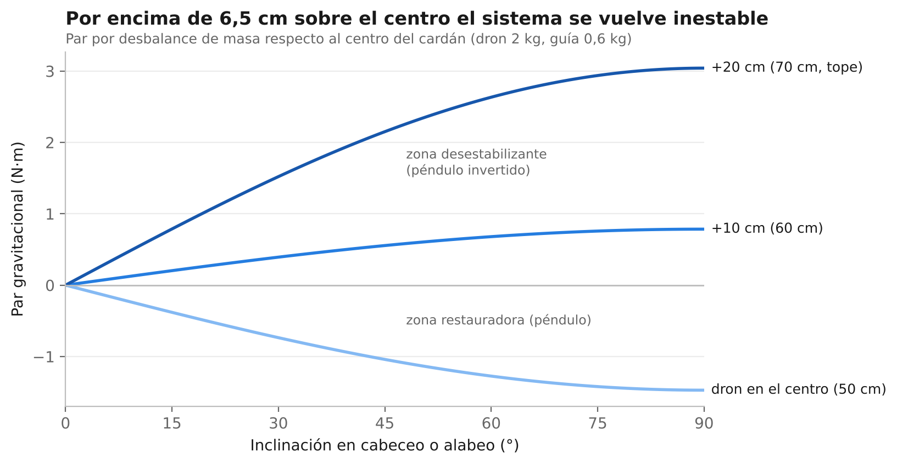

# Mesa de sintonización y prueba de empuje para drones

Proyecto PAE. Mesa de pruebas con un **cardán de tres ejes** (guiñada, alabeo y cabeceo) y un **sistema central de vuelo con 20 cm de recorrido vertical**. Sirve para **sintonizar drones multirrotor** y **verificar si los motores levantan el peso del dron** sin soltarlo. Admite cualquier dron que quepa dentro del aro interior de Ø 1,00 m.


## Contenido del repositorio

| Carpeta / archivo | Qué contiene |
|---|---|
| [`documento/resultados_mecanicos.md`](documento/resultados_mecanicos.md) | **Documento base y resultados mecánicos** (26-nov-2026): descripción, materiales, fabricación, masas, inercias, rigidez de aros, resistencia de ejes y rodamientos, estabilidad, costos y registro fotográfico. |
| [`documento/ficha_tecnica.md`](documento/ficha_tecnica.md) | Ficha técnica actualizada con los datos confirmados. |
| [`documento/Documentacion_mesa_sintonizacion_drones.docx`](documento/Documentacion_mesa_sintonizacion_drones.docx) | Documento en Word con la plantilla de trabajos de grado de la UNAL (versión del 21-nov-2026; ver nota de datos abajo). |
| [`documento/Documentacion_mesa_sintonizacion_drones.pdf`](documento/Documentacion_mesa_sintonizacion_drones.pdf) | El mismo documento en PDF. |
| [`estado_del_arte/Estado_del_arte_mesa_drones.xlsx`](estado_del_arte/Estado_del_arte_mesa_drones.xlsx) | Matriz del estado del arte: 39 fuentes, equipos comerciales, comparativo por grados de libertad y brechas. |
| [`imagenes/implementacion/`](imagenes/implementacion) | Fotografías de la implementación (26-nov-2026): chumaceras, rodamientos, frenos, guía vertical y uniones soldadas. |
| [`imagenes/resultados/`](imagenes/resultados) | Figuras de resultados mecánicos y láminas fotográficas del documento base. |
| [`imagenes/fabricacion/`](imagenes/fabricacion) | Fotogramas del video de la estructura (21-nov-2026). |
| [`imagenes/diseno/`](imagenes/diseno) | Esquema conceptual 3D, diagrama del sistema de vuelo y secuencia de fabricación. |
| [`imagenes/estado_del_arte/`](imagenes/estado_del_arte) | Gráfica de fuentes por categoría. |
| [`datos/`](datos) | Tablas de resultados en CSV (masas, inercias, FEM de aros, ejes, rodamientos, par gravitacional). |
| [`analisis/`](analisis) | Scripts en Python que calculan los resultados y generan las figuras. |
| [`cad/`](cad) | Modelo CAD del autor (Shapr3D) en STEP editable y en STL, con la lista de piezas y de planos pendientes. |
| [`fuentes/`](fuentes) | Video original de la estructura y transcripción de la descripción técnica del autor. |

## Especificaciones principales

| Elemento | Especificación |
|---|---|
| Configuración | Soporte en U + aro exterior + aro interior (cardán de 3 ejes) + guía vertical |
| Soporte en U | Semicírculo de Ø 1,50 m; gira en guiñada sobre eje de 7/8" × 18 cm y chumacera plana |
| Aro exterior | Ø 1,20 m; gira en alabeo sobre 2 brazos de 7/8" × 15 cm y 2 chumaceras de pie |
| Aro interior | Ø 1,00 m; gira en cabeceo sobre 2 muñones de 20 mm y 2 rodamientos 6004 (20 × 42 × 12 mm) |
| Estructura | Tubo galvanizado de 1/2", calibre 16 |
| Sistema de vuelo | Tubo galvanizado de 1/2" dentro de tubo de 5/8", arandelas torneadas; posición inicial 50 cm (dron en el centro del cardán), altura máxima 70 cm (recorrido de 20 cm) |
| Soporte del dron | PETG impreso; fijo con pasador para sintonizar o con giro libre sobre la guía |
| Frenos | Lámina de acero de 5 mm con 4 agujeros de 3/8"; bloqueo en 0° (posición de prueba) y en pasos de 45° |
| Ejes | Acero SAE 1020 de 7/8" |
| Base | Tubo cuadrado de 1", 80 cm de alto |
| Dimensiones generales | ≈ 2,20 m de alto × 1,80 m de ancho |
| Soldadura | SMAW con electrodo E6013 a ≈ 100 A |
| Costo de materiales | ≈ 637 000 COP |

## Resultados mecánicos (resumen)

| Resultado | Valor |
|---|---|
| Masa de aros y ejes | 8,86 kg (calculada) |
| Inercia del cardán (cabeceo / alabeo / guiñada) | 0,34 / 1,31 / 2,37 kg·m² |
| Flecha máxima (aro exterior, en reposo) | 3,0 mm |
| Factor de seguridad mínimo en ejes | 126 |
| Relación C0/carga mínima en rodamientos | 70 |
| Altura de equilibrio neutro | ≈ 6,5 cm sobre el centro |

| Inercia por eje | Par gravitacional |
|---|---|
|  |  |


## Repetir los cálculos

```bash
pip install -r analisis/requirements.txt
cd analisis
python3 calculos_mecanicos.py   # imprime resultados y escribe datos/*.csv
python3 figuras.py              # regenera imagenes/resultados/
python3 render_cad.py           # vistas del CAD (descomprima antes cad/stl/aro_exterior.zip y aro_interior.zip)
```

Las hipótesis están al inicio de `calculos_mecanicos.py`. Al cambiarlas por valores medidos, se actualizan todas las tablas y figuras.

## Pendiente

- [x] Modelo CAD en STEP y STL (ver `cad/README.md`).
- [ ] Planos en PDF (vista general con cotas y despiece).
- [ ] Fotografía del producto terminado (después de pintar y montar).
- [ ] Ensayos de fricción en los ejes y validación de masas con báscula.

## Notas

- **Datos corregidos el 26-nov-2026:** rodamientos 6004 en el cabeceo (antes R15/6205), muñones de 20 mm (antes 22 mm), altura máxima de la guía 70 cm (antes 75 cm). El Word y el PDF de `documento/` todavía tienen los valores anteriores; el documento vigente es `documento/resultados_mecanicos.md`.
- Las fotos de `imagenes/fabricacion/` son fotogramas del video, con resolución limitada; las de `imagenes/implementacion/` son las originales.
- El esquema 3D de `imagenes/diseno/` es ilustrativo; el modelo real del autor está en `cad/`.
- Al abrir el Word, acepte "Actualizar campos" para que se llenen el contenido y las listas de figuras y tablas.
