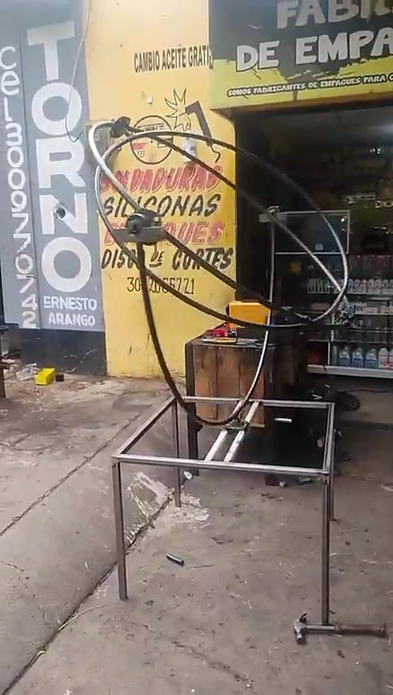
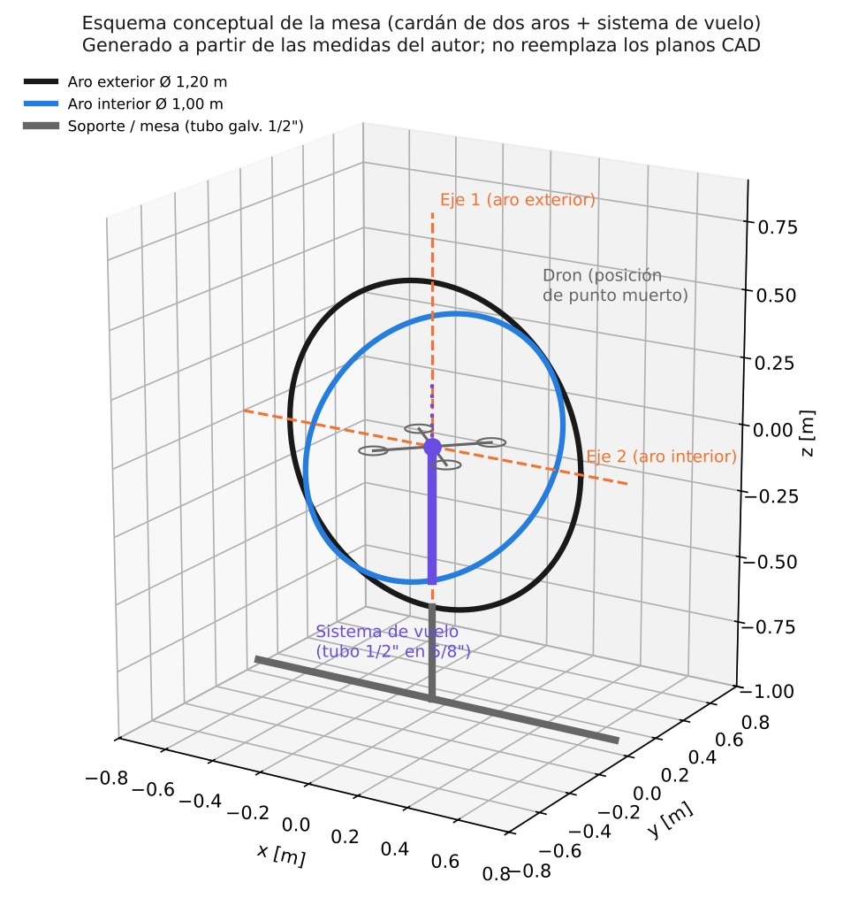
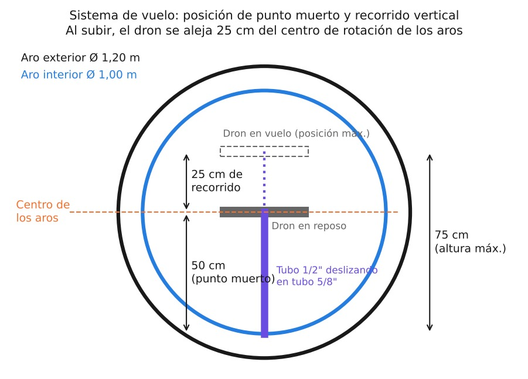
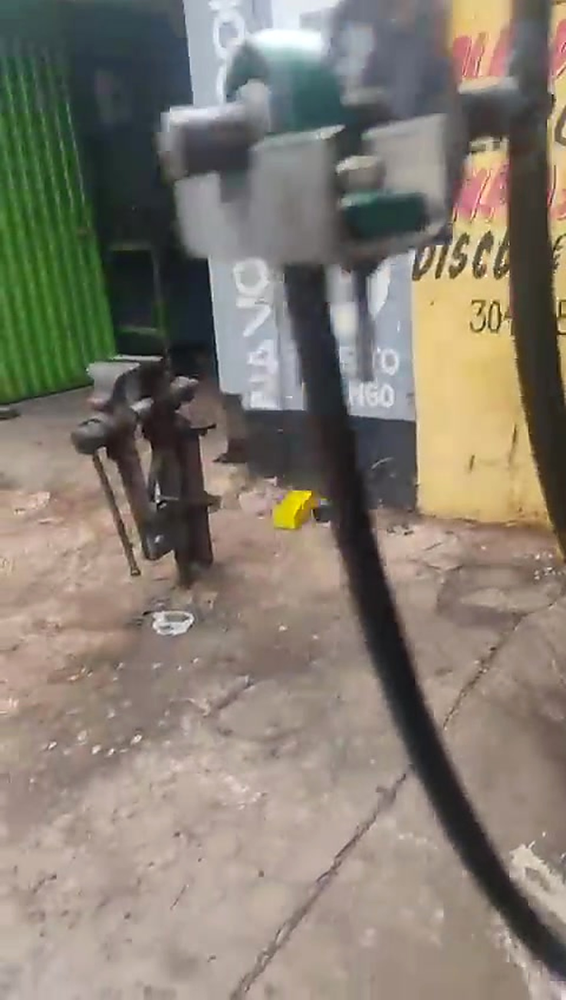
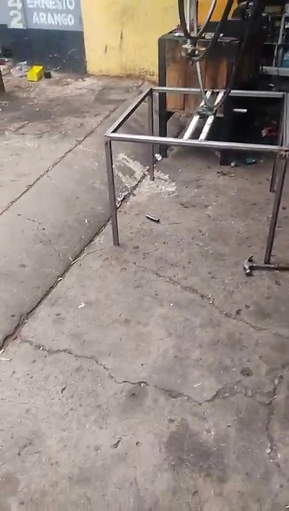

# Mesa de sintonización y prueba de empuje para drones

Proyecto PAE. Mesa de pruebas con un cardán de dos aros y un sistema central de vuelo con recorrido vertical. Sirve para **sintonizar drones multirrotor** y **verificar si los motores levantan el peso del dron** sin soltarlo.

## Contenido del repositorio

| Carpeta / archivo | Qué contiene |
|---|---|
| [`documento/Documentacion_mesa_sintonizacion_drones.docx`](documento/Documentacion_mesa_sintonizacion_drones.docx) | Documento principal en Word con el formato de la plantilla de trabajos de grado de la Universidad Nacional de Colombia: preliminares, planteamiento, objetivos, estado del arte, materiales y métodos, protocolo de pruebas, discusión, conclusiones, anexos y referencias. |
| [`documento/Documentacion_mesa_sintonizacion_drones.pdf`](documento/Documentacion_mesa_sintonizacion_drones.pdf) | El mismo documento en PDF, con índices ya numerados, para revisión rápida. |
| [`estado_del_arte/Estado_del_arte_mesa_drones.xlsx`](estado_del_arte/Estado_del_arte_mesa_drones.xlsx) | Matriz del estado del arte: 39 fuentes con resumen, aporte, relación con el proyecto y enlace, más equipos comerciales, referencias técnicas, comparativo por grados de libertad y brechas. |
| [`imagenes/fabricacion/`](imagenes/fabricacion) | Fotografías de la estructura y de los detalles mecánicos (JPG). |
| [`imagenes/diseno/`](imagenes/diseno) | Esquema conceptual 3D, diagrama del sistema de vuelo y secuencia de fabricación (JPG). |
| [`imagenes/estado_del_arte/`](imagenes/estado_del_arte) | Gráfica de fuentes por categoría (JPG). |
| [`cad/`](cad) | Espacio para planos y modelos CAD (pendiente). |
| [`fuentes/`](fuentes) | Video original de la estructura y transcripción de la descripción técnica del autor. |

## Especificaciones principales

| Elemento | Especificación |
|---|---|
| Soporte en U | 1,50 m |
| Aro exterior | Ø 1,20 m |
| Aro interior | Ø 1,00 m |
| Estructura | Tubo galvanizado de 1/2", calibre 16 |
| Sistema de vuelo | Tubo galvanizado de 1/2" dentro de tubo de 5/8", arandelas torneadas; punto muerto 50 cm, altura máxima 75 cm (recorrido de 25 cm) |
| Base y garra del dron | PETG impreso en 3D; tubo cuadrado de 1" para el ancho de la base |
| Apoyos | 1 chumacera plana y 2 chumaceras redondas con balineras R15; rodamientos 6205 soldados a la base |
| Ejes | Acero torneado de 7/8" y ejes a 22 mm |
| Soldadura | SMAW con electrodo E6013 a ≈100 A |

## Figuras

| Diseño | Sistema de vuelo |
|---|---|
|  |  |

| Detalle de chumacera y eje | Marco de la mesa |
|---|---|
|  |  |

## Pendiente

- [ ] Planos y modelos CAD (ver `cad/README.md`).
- [ ] Masa del dron de prueba y de sus componentes (motores, hélices, batería, controladora).
- [ ] Masa de cada aro y del sistema de vuelo.
- [ ] Designación exacta de las balineras R15 y ajuste entre ejes de 22 mm y rodamientos 6205 (agujero de 25 mm).
- [ ] Método de conformado de los aros y parámetros de impresión del PETG.
- [ ] Instrumentación prevista (encoders, IMU, celda de carga, sensor de corriente).
- [ ] Fotografías en alta resolución del proceso de fabricación.

## Notas

- Las fotografías son fotogramas del video de la estructura, así que su resolución es limitada.
- El esquema 3D se generó a partir de las medidas del autor; es ilustrativo y no reemplaza los planos CAD.
- Al abrir el Word, acepte "Actualizar campos" para que se llenen el contenido, la lista de figuras y la lista de tablas.
- El formato sigue la plantilla oficial de tesis y trabajos finales de la UNAL. No usa la fuente Ancizar, porque la plantilla advierte que restringe la copia en el Repositorio Institucional. Falta insertar el escudo de la Universidad en la portada.
