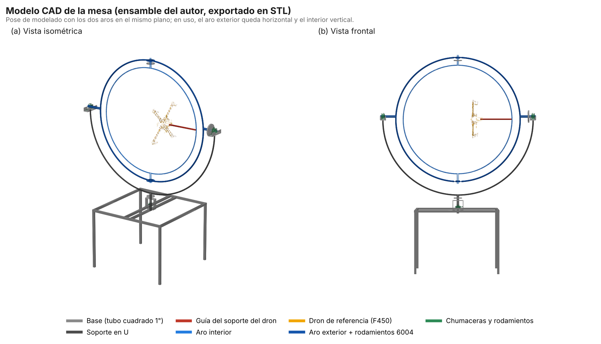

# Mesa de sintonización y prueba de empuje para drones multirrotor

Proyecto PAE – Universidad Nacional de Colombia, Sede de La Paz. Autor: Maicol Ardila.

Mesa de pruebas con un cardán de tres ejes (guiñada, alabeo y cabeceo) y una guía vertical de 20 cm. Sirve para sintonizar drones multirrotor y verificar si sus motores levantan su peso, sin soltar el dron.



## Documento principal

El documento base reúne en un solo lugar el estado del arte, el diseño, la fabricación, los resultados mecánicos, el protocolo de pruebas, las conclusiones, los costos y las referencias. Está en tres formatos con el mismo contenido:

- [`documento/documento_base.md`](documento/documento_base.md): para leer aquí en GitHub.
- [`documento/documento_base.docx`](documento/documento_base.docx): Word editable.
- [`documento/documento_base.pdf`](documento/documento_base.pdf): PDF para imprimir o enviar.

## Contenido del repositorio

| Carpeta | Qué contiene |
|---|---|
| [`documento/`](documento) | Documento base (Markdown, Word y PDF). |
| [`estado_del_arte/`](estado_del_arte) | Matriz del estado del arte en Excel: 39 fuentes, equipos comerciales, comparativo por grados de libertad y brechas. |
| [`cad/`](cad) | Modelo CAD del autor (Shapr3D) en STEP editable y en STL, con la lista de piezas. |
| [`imagenes/implementacion/`](imagenes/implementacion) | Fotografías originales de la mesa construida. |
| [`imagenes/resultados/`](imagenes/resultados) | Figuras de resultados, vista del CAD y láminas fotográficas del documento. |
| [`imagenes/fabricacion/`](imagenes/fabricacion) | Vista general de la estructura y de la base en el taller (fotogramas del video). |
| [`imagenes/estado_del_arte/`](imagenes/estado_del_arte) | Gráfica de fuentes por categoría. |
| [`datos/`](datos) | Resultados mecánicos en CSV: masas, inercias, rigidez de aros, ejes, rodamientos y par gravitacional. |
| [`analisis/`](analisis) | Scripts en Python que calculan los resultados y generan las figuras. |
| [`fuentes/`](fuentes) | Registro original del 21-nov-2026: video de la estructura y transcripción de la descripción del autor. Algunos datos de ese registro se corrigieron después; los vigentes están en el documento base. |

## Repetir los cálculos

```bash
pip install -r analisis/requirements.txt
cd analisis
python3 calculos_mecanicos.py   # resultados en consola y datos/*.csv
python3 figuras.py              # regenera imagenes/resultados/
python3 render_cad.py           # vistas del CAD (descomprima antes cad/stl/aro_exterior.zip y aro_interior.zip)
```

Las hipótesis están al inicio de `calculos_mecanicos.py`; al reemplazarlas por valores medidos se actualizan todas las tablas y figuras.

## Pendiente

- Planos en PDF (vista general con cotas y despiece).
- Fotografía del producto terminado (después de pintar y montar).
- Medir el diámetro exterior real del tubo y pesar la guía vertical para validar los cálculos.
