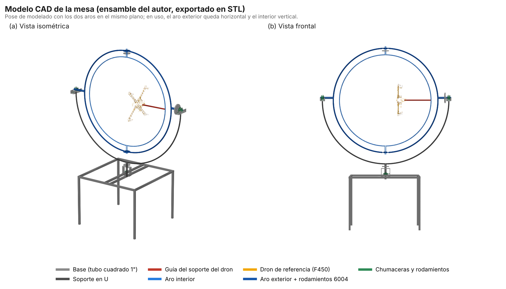

# Modelo CAD

Ensamble de la mesa modelado por el autor en Shapr3D y exportado en STEP (AP242, editable) y STL (visualización). Unidades: mm. Está en una pose de modelado con los dos aros en el mismo plano; en uso, el aro exterior queda horizontal y el interior vertical.

## Archivos en `stl/`

Los dos aros van comprimidos en `.zip` para no superar el límite de carga; descomprímalos antes de abrirlos.

| Archivo | Pieza | Medidas del sólido (mm) |
|---|---|---|
| `Cuerpo 17.stl` | Soporte en U (semicírculo) | 1 463 × 22 × 902 |
| `aro_interior.zip` → `aro_interior.stl` (exportado como `Cuerpo 61 (1)`) | Aro interior con muñones superior e inferior (comprimido) | 1 060 × 20 × 1 245 |
| `aro_exterior.zip` → `aro_exterior.stl` | Aro exterior con brazos laterales y alojamientos de los rodamientos (comprimido). Se quitaron los modelos SKF de los rodamientos 6004 que venían en el mismo archivo | 1 502 × 80 × 1 211 |
| `Cuerpo 15 (2).stl` | Base de tubo cuadrado 1" | 802 × 805 × 600 |
| `Cuerpo 21.stl`, `Cuerpo 21 (1).stl`, `Cuerpo 21 (2).stl`, `Cuerpo 21 (1) 2.stl` | Canales de apoyo de las chumaceras de pie | 25 × 150 × 38 c/u |
| `Cuerpo 33.stl` | Soporte tipo freno (placa) en el eje de alabeo | 120 × 120 × 10 |
| `Cuerpo 61.stl`, `Cuerpo 61 (1) 2.stl` | Placas de 5 mm (superior y en el eje de guiñada) | 80 × 80 × 5 c/u |
| `Cuerpo 36.stl` | Guía del soporte del dron, Ø 12,7 mm | 300 × 13 × 13 |
| `Cuerpo 36 (1).stl` | Soporte de la chumacera plana sobre la base | 103 × 40 × 105 |

## Archivos en `step/`

Mismas piezas que en `stl/`, en formato STEP para abrir y editar en cualquier programa CAD (SolidWorks, Fusion 360, FreeCAD, Inventor, Shapr3D).

| Archivo | Pieza |
|---|---|
| `Cuerpo 17.step` | Soporte en U |
| `aro_interior.step` (exportado como `Cuerpo 61 (1)`) | Aro interior con muñones |
| `aro_exterior_con_rodamientos_6004.step` | Aro exterior con brazos laterales; incluye los rodamientos 6004 del modelo SKF, que venían en el mismo cuerpo |
| `Cuerpo 15 (2).step` | Base de tubo cuadrado 1" |
| `Cuerpo 21*.step` (4) | Canales de apoyo de las chumaceras de pie |
| `Cuerpo 33.step` | Soporte tipo freno del eje de alabeo |
| `Cuerpo 61.step`, `Cuerpo 61 (1)_2.step` | Placas de 5 mm |
| `Cuerpo 36.step` | Guía del soporte del dron |
| `Cuerpo 36 (1).step` | Soporte de la chumacera plana |

## Piezas de terceros (no incluidas aquí)

El ensamble original también usa modelos descargados de fabricantes y de bibliotecas en línea: brazo de dron F450 (118 MB), rodamiento SKF 6004 (15 MB), unidad SKF FY (24 MB) y dos chumaceras de 20 mm (19 MB c/u). No se suben al repositorio por tamaño (GitHub no acepta archivos de más de 100 MB y su página de carga no acepta más de 25 MB) y porque su licencia es la de cada fuente. El paquete completo `Mesa_trabajo_de_grado_STL_2.zip` (111 MB) puede publicarse como archivo adjunto de un *Release* del repositorio.

## Pendiente

| Plano | Contenido mínimo | Estado |
|---|---|---|
| Exportación STEP | Ensamble editable | Hecho (`step/`) |
| Ensamble general (PDF) | Vistas principales, cotas generales y lista de piezas | Pendiente |
| Ejes torneados | Eje de la U 7/8" × 18 cm; brazos 7/8" × 15 cm; muñones torneados a Ø 20 mm para rodamientos 6004 | Pendiente |
| Sistema de vuelo | Tubos 1/2" y 5/8", arandelas torneadas, topes de 50 y 70 cm, pasador del soporte | Pendiente |
| Soportes tipo freno | Lámina 5 mm octogonal, 4 agujeros de 3/8" a 45° | Pendiente |
