# Resumen

Se diseñó, fabricó e implementó una mesa de pruebas para drones multirrotor con cuatro grados de libertad: un cardán de tres ejes (guiñada, alabeo y cabeceo) y una guía vertical con 20 cm de recorrido. El dron vuela restringido en el centro del cardán, sin soltarse, para sintonizar sus controladores y verificar si los motores levantan su peso. La estructura se construyó en tubo galvanizado de 1/2" calibre 16, ejes de acero SAE 1020 de 7/8", chumaceras de 7/8", rodamientos 6004, soldadura SMAW con electrodo E6013 y piezas impresas en PETG, con un costo de materiales de unos 637 000 COP.

Los resultados mecánicos calculados muestran que la estructura está sobredimensionada en resistencia (factor de seguridad de los ejes mayor de 120 y relación capacidad estática/carga de los rodamientos mayor de 70) y que su rigidez es suficiente (flecha máxima de 3,0 mm). El límite del diseño es dinámico: el cardán aporta entre 30 y 116 veces la inercia de un dron de 2 kg, y el sistema pasa de estable a inestable cuando el dron sube más de unos 6,5 cm sobre el centro. La revisión de 39 fuentes ubica la mesa en la categoría de bancos de cuatro grados de libertad, poco representada en la literatura y sin antecedentes directos en Colombia.

**Palabras clave:** banco de pruebas, dron multirrotor, cardán, sintonización PID, relación empuje/peso, diseño mecánico.

# Abstract

A test bench for multirotor drones with four degrees of freedom was designed, built and implemented: a three-axis gimbal (yaw, roll and pitch) and a vertical guide with 20 cm of travel. The drone flies restrained at the centre of the gimbal, without being released, to tune its controllers and to check whether its motors can lift its weight. The structure was built from 1/2" 16-gauge galvanized tube, 7/8" SAE 1020 steel shafts, 7/8" mounted bearings, 6004 ball bearings, SMAW welding with E6013 electrodes and PETG printed parts, at a material cost of about COP 637,000.

The computed mechanical results show that the structure is oversized in strength (shaft safety factor above 120 and bearing static capacity-to-load ratio above 70) and stiff enough (maximum deflection of 3.0 mm). The design limit is dynamic: the gimbal adds 30 to 116 times the inertia of a 2 kg drone, and the system goes from stable to unstable when the drone rises more than about 6.5 cm above the centre. A review of 39 sources places the bench among four-degree-of-freedom rigs, a category with few published examples and no direct precedent in Colombia.

**Keywords:** test bench, multirotor drone, gimbal, PID tuning, thrust-to-weight ratio, mechanical design.

# Símbolos y abreviaturas

| Símbolo | Término | Unidad SI |
|---|---|---|
| C0 | Capacidad de carga estática de un rodamiento | N |
| E, G | Módulos de elasticidad y de cortante | Pa |
| h | Altura del dron sobre el centro del cardán | m |
| I | Momento de inercia de masa | kg·m² |
| m | Masa | kg |
| Sy | Esfuerzo de fluencia | Pa |
| T/W | Relación empuje/peso | — |
| θ | Ángulo de inclinación | rad |
| τ | Par gravitacional | N·m |

| Abreviatura | Término |
|---|---|
| CAD | Diseño asistido por computador |
| CG | Centro de gravedad |
| FDM | Modelado por deposición fundida (impresión 3D) |
| GDL | Grados de libertad |
| PETG | Tereftalato de polietileno modificado con glicol |
| PID | Controlador proporcional-integral-derivativo |
| RAC | Reglamento Aeronáutico de Colombia |
| SMAW | Soldadura por arco con electrodo revestido |
| UAV / UAS | Vehículo / sistema aéreo no tripulado |

# 1. Introducción

Ajustar los controladores de vuelo de un dron multirrotor directamente en vuelo libre es un proceso iterativo y riesgoso: una ganancia mal elegida puede producir oscilaciones, pérdida de control y daños al equipo o a las personas. Por eso la literatura propone bancos de prueba que restringen el movimiento del vehículo y sirven como paso intermedio entre la simulación y el vuelo real [1], [5], [16].

Este trabajo documenta una mesa construida con ese fin. Su estructura es un cardán de tres ejes que deja girar libremente al dron, y en el centro tiene una guía vertical que le permite subir 20 cm. Su propósito es doble: sintonizar el dron y verificar si los motores están bien dimensionados para su peso. El dron no se suelta en ningún momento. El alcance de este documento es mecánico; la instrumentación la documenta otro integrante del equipo.

El capítulo 2 plantea el problema; el 3, los objetivos; el 4 revisa el estado del arte; el 5 describe el diseño y la fabricación; el 6 presenta los resultados mecánicos; el 7, el registro fotográfico; el 8 propone un protocolo de pruebas; el 9 discute limitaciones y aportes; el 10 presenta conclusiones, y el 11, los costos.

# 2. Planteamiento del problema y justificación

## 2.1 Planteamiento del problema

Antes de volar un dron nuevo, o después de cambiarle motores, hélices o carga útil, es necesario ajustar sus controladores y comprobar que el sistema de propulsión puede levantarlo. Hacerlo en vuelo libre expone el equipo a choques y obliga a operar en el espacio aéreo, que en Colombia está regulado por el RAC 100 de la Aerocivil [50]. Los bancos comerciales que permiten hacer estas pruebas de forma segura se venden bajo cotización y requieren importación [51], [55].

## 2.2 Justificación

La literatura muestra que los bancos de prueba reducen el riesgo y el tiempo de desarrollo, y que pueden fabricarse con recursos de bajo costo [3], [5], [32]. Sin embargo, son pocos los trabajos que combinan rotación libre con movimiento vertical en un mismo equipo [7], [9], [10], y una patente señala que la técnica previa usaba dispositivos separados para la prueba de inclinación y la de elevación [39]. En Colombia los antecedentes encontrados se limitan a bancos de parámetros [26] y a una plataforma de solo desplazamiento vertical [27].

Una mesa fabricada con tubo galvanizado, soldadura convencional e impresión 3D, en un taller local, resuelve las dos pruebas en un solo equipo y aporta a la región un recurso para la formación y la investigación en vehículos aéreos no tripulados.

# 3. Objetivos

## 3.1 Objetivo general

Diseñar, construir y documentar una mesa de pruebas tipo cardán con sistema de vuelo vertical que permita sintonizar drones multirrotor y verificar su capacidad de levante de forma segura.

## 3.2 Objetivos específicos

1. Revisar el estado del arte de bancos de prueba para multirrotores y ubicar la mesa dentro de su clasificación por grados de libertad.
2. Diseñar y fabricar la mesa, y documentar sus materiales, componentes y procesos.
3. Evaluar mecánicamente la mesa: masas, inercias, rigidez, resistencia de ejes y rodamientos y estabilidad.
4. Definir un protocolo de pruebas para la sintonía del controlador y la verificación de empuje.
5. Identificar las limitaciones del banco frente al vuelo libre y proponer mejoras.

# 4. Marco teórico y estado del arte

Se revisaron 39 fuentes: artículos de revista y de congreso, tesis, patentes y documentación técnica; 9 provienen de Latinoamérica (Figura 1). La mayoría corresponde a bancos de tres grados de libertad tipo cardán; los bancos que, como esta mesa, combinan rotación libre con movimiento vertical son pocos. La matriz completa está en `estado_del_arte/Estado_del_arte_mesa_drones.xlsx`.

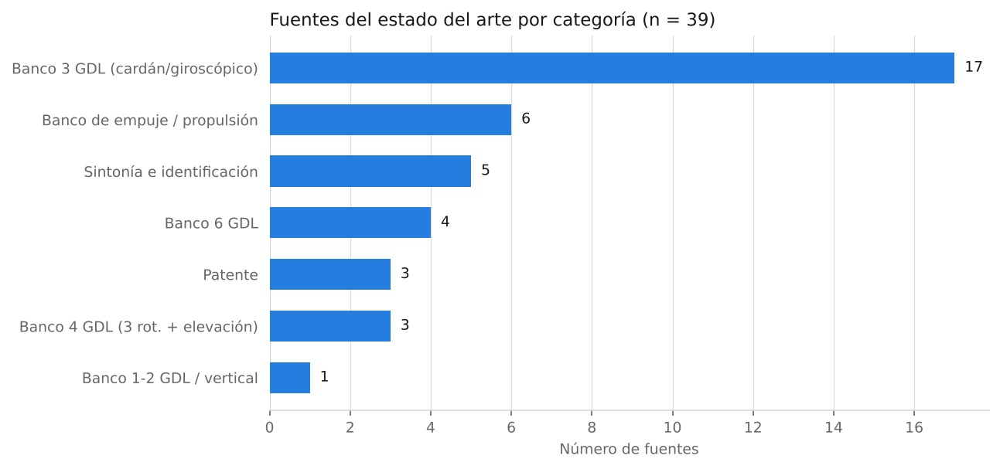

## 4.1 Bancos de prueba para multirrotores

Los bancos se clasifican según los grados de libertad (GDL) que dejan al vehículo: desde soportes de un solo eje hasta plataformas de seis GDL que se aproximan al vuelo libre [8].

**Tabla 1.** Tipos de bancos de prueba y ubicación de la mesa.

| Tipo de banco | Qué permite probar | N.º | Limitaciones | ¿Lo cubre la mesa? |
|---|---|---|---|---|
| Banco 1-2 GDL / vertical | Un eje de rotación o solo altura | 1 | No reproduce el acoplamiento entre ejes | Sí (eje vertical de 20 cm) |
| Banco 3 GDL (cardán/giroscópico) | Alabeo, cabeceo y guiñada sin traslación | 17 | Inercia y fricción añadidas; sin altura | Sí (cardán de tres ejes) |
| Banco 4 GDL (3 rot. + elevación) | Actitud + altura limitada | 3 | Pocos trabajos; fricción/pandeo en el eje vertical | Sí: es la categoría de la mesa |
| Banco 6 GDL | Movimiento casi libre restringido | 4 | Complejo, costoso, más riesgo | No |
| Banco de empuje / propulsión | Empuje, par, RPM, potencia | 6 | No prueba el control del dron completo | Parcial: verifica si levanta, sin medir empuje |
| Sintonía e identificación | Métodos para sintonizar/identificar | 5 | Dependen del banco usado | Aplicable sobre la mesa |
| Patente | Soluciones protegidas | 3 | Poca información de desempeño | Referencia de novedad |

## 4.2 Trabajos más relevantes

**Tabla 2.** Fuentes de relevancia alta y su relación con la mesa.

| Ref. | Autor(es), año | Aporte clave | Relación con la mesa |
|---|---|---|---|
| [1] | Sharma et al., 2023 | Cuatro requisitos de un cardán de prueba: rotación libre en 3 ejes, mínima inercia añadida, compatibilidad con motores débiles y sensado que no interfiera. | Lista de requisitos para evaluar el diseño; la inercia añadida se cuantifica en la sección 6.3. |
| [2] | Hancer et al., 2018 | Usa el banco para sintonizar ganancias PID antes del vuelo estacionario. | Antecedente directo del uso de un cardán para sintonizar PID con autopiloto comercial. |
| [3] | Veyna et al., 2021 | Banco abierto para probar algoritmos en Matlab-Simulink, con PID y realimentación de estados. | Referente de diseño mecánico y uso didáctico. |
| [4] | Ahmad et al., 2024 | PID y LQR en tiempo real; trata la configuración tipo péndulo del banco. | Útil para modelar el efecto péndulo cuando la guía sube 20 cm (sección 6.7). |
| [5] | Bondyra et al., 2017 | Paso intermedio entre simulación y vuelo; bajo costo con piezas FDM. | Muestra cómo instrumentar los ejes de los aros. |
| [6] | Gąsior et al., 2018 | Forma segura de obtener ganancias iniciales de actitud y de movimiento vertical. | Vincula la prueba de empuje con la sintonía, los dos objetivos de la mesa. |
| [7] | Botha et al., 2024 | Masa y fricción añadidas alteran la dinámica; el eje de PETG se pandeó; se necesitó acelerador casi a fondo para subir. | Concepto parecido a la guía telescópica; sus problemas son lecciones aplicables. |
| [9] | Di Lorenzo, 2020 | PID, LQR y modo deslizante; diferencias entre banco y vuelo real. | Antecedente más cercano en GDL (4). |
| [10] | Berndt Barriga, 2024 | Guiñada < 360° y elevación bloqueada en la versión final; sobreimpulso en banco y error estacionario en vuelo libre. | Muestra la necesidad de comparar banco y vuelo libre y de liberar la elevación, que la mesa ofrece (20 cm). |
| [13] | Castillo Lou, 2022 | Plataforma gimbal para drones de mediana potencia con autopiloto abierto. | Mismo rango de drones; buen par de comparación. |
| [15] | Nájera et al., 2023 | Defectos típicos: fricción asimétrica, CG desplazado, controladora limitada. | Lecciones sobre equilibrado del CG y fricción. |
| [18] | Khudairi et al., 2025 | Modelos identificados en banco para sintonizar un PID. | Apoya el uso de la mesa para identificación y sintonía. |
| [23] | Beharie et al., 2015 | Relaciones medidas para un modelo de 6 GDL. | Fundamenta la verificación de motores frente al peso del dron. |
| [24] | Hoshu et al., 2022 | Sintonía automática validada con vuelos. | Método de sintonía ejecutable sobre la mesa. |
| [26] | Quitian Niño, 2022 | Regresiones velocidad-empuje y velocidad-par. | Antecedente colombiano clave. |
| [27] | Blanco Ortiz, 2016 | Planta vertical con medición de altura, corriente y voltaje. | Antecedente colombiano del eje vertical. |
| [34] | arXiv, 2025 | El cardán generó momentos grandes que obligaron a usar ganancias más altas que en vuelo libre. | Evidencia de que las ganancias de la mesa no se trasladan 1:1. |
| [39] | Patente US 11,674,867 | La técnica previa requería dos dispositivos para inclinación y elevación. | Respalda reunir sintonía y prueba de levante en un solo equipo. |

## 4.3 Antecedentes en Colombia y Latinoamérica

En Colombia se encontraron dos antecedentes directos: bancos para medir los parámetros del modelo dinámico de drones en la Universidad Nacional, sede Bogotá [26], y una planta de pruebas para cuadricóptero con desplazamiento vertical en la Universidad Distrital [27]. En la región destacan bancos cardán en México [11], [12] y Guatemala [13], y un banco de cuatro GDL en Chile [10]. No se encontró en Colombia un banco que combine cardán y recorrido vertical.

## 4.4 Equipos comerciales

**Tabla 3.** Equipos comerciales de referencia (fichas consultadas en noviembre de 2026).

| Ref. | Equipo | Tipo | Capacidad / GDL | Relación con la mesa |
|---|---|---|---|---|
| [51] | Quanser 3 DOF Hover | Banco didáctico 3 GDL | Alabeo, cabeceo y guiñada | Referente comercial del cardán de sintonía. |
| [52] | Quanser 3 DOF Helicopter | Banco didáctico 3 GDL | Cabeceo, desplazamiento y elevación | Encoders por eje como estándar comercial. |
| [53] | Tyto Robotics Series 1585 | Banco de empuje | Hasta 5 kgf y 2 N·m; 50 V; 55 A | Variables a medir para verificar el levante. |
| [54] | Tyto Robotics Flight Stand 150/500 | Banco de empuje (eVTOL) | 150–500 kgf | Escala superior; no aplica directamente. |
| [55] | Eureka Dynamics FFT-GYRO | Cardán 3 GDL | Distancia entre rotores 100–2000 mm; marco hasta 2750 mm | Equivalente comercial más parecido; alinea el centro de rotación. |

## 4.5 Criterios para la prueba de empuje

Para un control estable se recomienda que el empuje máximo sea al menos el doble del peso del dron [46], y que el vuelo estacionario ocurra entre el 50 % y el 55 % del acelerador [47]. Estos criterios sirven para interpretar la prueba de levante y fijan el caso de cálculo de este documento (T/W = 2).

## 4.6 Sintonía de controladores

Las guías de los autopilotos de código abierto recomiendan ajustar primero el lazo de velocidad angular y subir las ganancias de forma gradual [48]. La sintonía automática de ArduPilot exige que el dron ya sea capaz de mantener altura [49], condición que debe revisarse con solo 20 cm de recorrido. En la literatura de bancos se usan Ziegler-Nichols [17], realimentación por relé [24] e identificación previa del modelo [18].

# 5. Diseño y fabricación

## 5.1 Descripción general

La mesa es un cardán de tres aros concéntricos cuyos ejes se cruzan en un punto, donde se ubica el dron (Figura 2 y Figura 3). Admite cualquier dron que quepa dentro del aro interior de Ø 1,00 m. Sus dimensiones generales son unos 2,20 m de alto (base de 80 cm + eje de 12 cm + semicírculo en U + aro interior) y 1,80 m de ancho.

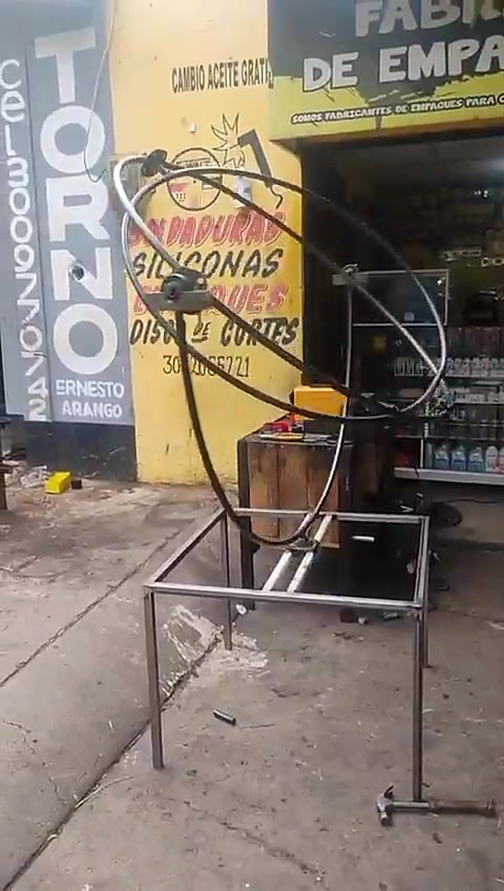

**Tabla 4.** Ejes de movimiento.

| Eje | Movimiento | Elemento móvil | Apoyo | Rango |
|---|---|---|---|---|
| Z (vertical) | Guiñada | Soporte en U, Ø 1,50 m | 1 chumacera plana 7/8" soldada a la base | 360° |
| X (horizontal) | Alabeo | Aro exterior, Ø 1,20 m (horizontal en reposo) | 2 chumaceras de pie 7/8" en las puntas de la U | 360° |
| Y (horizontal, ⊥ X) | Cabeceo | Aro interior, Ø 1,00 m (vertical en reposo) | 2 rodamientos 6004 en placas soldadas al aro exterior | 360° |
| Z (traslación) | Altura | Guía vertical telescópica | Tubo dentro de tubo con arandelas de tope | 50 → 70 cm (20 cm) |

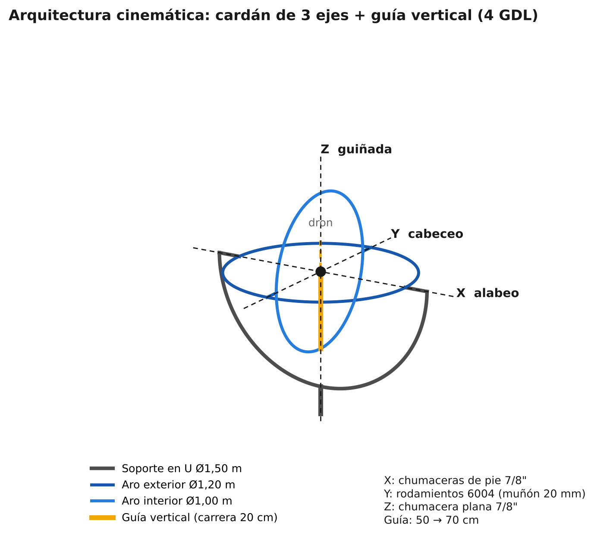

## 5.2 Sistema de vuelo y modos de uso

La guía vertical es un tubo galvanizado de 1/2" que desliza dentro de un tubo de 5/8", con arandelas torneadas. Sale del punto inferior del aro interior y en su posición inicial mide 50 cm, igual al radio del aro, así que el soporte del dron queda en el centro del cardán. Al subir a 70 cm el dron queda 20 cm por encima del centro (Figura 4). El soporte del dron, impreso en PETG, gira libre sobre la guía cuando se retira su pasador.

Cada eje tiene un soporte tipo freno en lámina de acero de 5 mm con 4 agujeros de 3/8" (9,5 mm). Un perno por esos agujeros bloquea el eje en 0°, la posición de prueba (punto muerto, dron en el centro de la mesa), o en pasos de 45° hasta completar 360°. La mesa tiene dos modos de uso:

- **Sintonización:** soporte del dron fijo con el pasador y ejes del cardán libres (todos, o uno a la vez bloqueando los demás).
- **Prueba de empuje:** los tres ejes bloqueados en 0°; el dron solo puede subir por la guía, y así se comprueba si los motores levantan su peso.

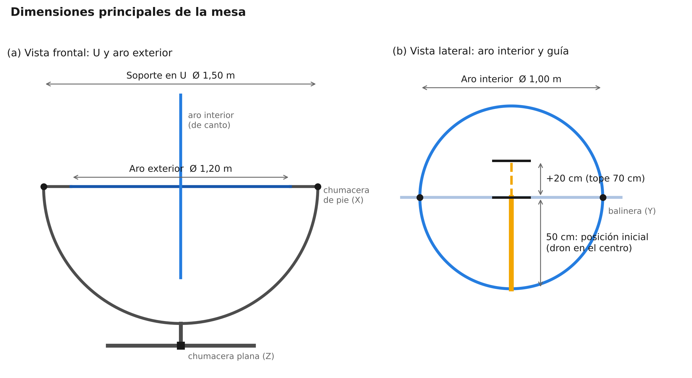

## 5.3 Modelo CAD

El autor modeló el ensamble completo en Shapr3D, con rodamientos, chumaceras y un dron F450 de referencia (Figura 5). El modelo está en `cad/` en formato STEP (editable) y STL.

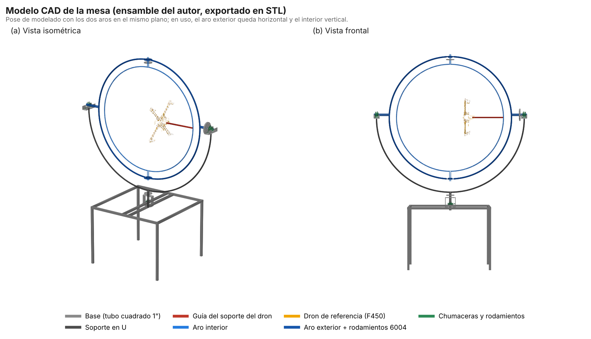

## 5.4 Materiales y componentes

Todos los ejes y alojamientos se unificaron en 7/8" (22,2 mm), salvo los muñones del aro interior, rebajados a 20 mm.

**Tabla 5.** Lista de materiales y componentes.

| Componente | Cant. | Especificación | Ubicación / función |
|---|---|---|---|
| Chumacera plana (brida, 2 agujeros) | 1 | Eje 7/8" (tipo UCFL205-14) | Eje de guiñada, soldada a la base |
| Chumacera de pie | 2 | Eje 7/8" (tipo UCP205-14) | Eje de alabeo, en canales de acero en las puntas de la U |
| Rodamiento rígido de bolas 6004 | 2 | 20 × 42 × 12 mm; C = 10,0 kN, C0 = 5,0 kN [40], [41] | Eje de cabeceo, en placas de 5 mm soldadas al aro exterior |
| Eje vertical de la U | 1 | Acero SAE 1020, Ø 7/8", 18 cm | Guiñada: une la U con la chumacera plana |
| Brazos laterales | 2 | Acero SAE 1020, Ø 7/8", 15 cm c/u | Alabeo: unen el aro exterior con las chumaceras de pie |
| Muñones del aro interior | 2 | Acero SAE 1020, Ø 7/8" torneado a Ø 20 mm, 10 cm c/u | Cabeceo: unen el aro interior con los rodamientos |
| Tubería galvanizada | 4 tubos de 6 m | 1/2", calibre 16 (Ø ext. 21,3 mm, e = 1,5 mm) | Semicírculo en U Ø 1,50 m; aros Ø 1,20 m y Ø 1,00 m |
| Soportes tipo freno | 3 | Lámina de acero 5 mm, octogonal, 4 agujeros de 3/8" | Bloqueo de cada eje en 0° y en pasos de 45° |
| Guía vertical | 1 | Tubo galvanizado 1/2" dentro de tubo 5/8", arandelas torneadas | Recorrido del dron, 50 → 70 cm |
| Soporte del dron | 1 | PETG impreso (FDM), con pasador [43]–[45] | Fijo (sintonización) o con giro libre sobre la guía |
| Base | 1 | Tubo cuadrado 1" (2 tubos de 6 m) | Bastidor inferior, 80 cm de alto |
| Soldadura | — | Electrodo E6013 (AWS A5.1), ≈ 100 A [42] | Todas las uniones |

## 5.5 Procesos de fabricación

1. Curvado de la tubería galvanizada de 1/2" cal. 16 para formar el semicírculo en U y los dos aros.
2. Corte de los ejes de 7/8" y torneado de los muñones del aro interior a Ø 20 mm para los rodamientos 6004.
3. Corte de los soportes tipo freno en lámina de 5 mm (perfil octogonal con agujeros de 3/8").
4. Soldadura de los ejes a los aros en unión en T (Lámina 1f) y de las placas porta-rodamiento al aro exterior, con electrodo E6013 a unos 100 A.
5. Montaje de la chumacera plana sobre la base y de las chumaceras de pie en canales de acero en las puntas de la U.
6. Fabricación de la guía telescópica con arandelas de tope soldadas (Lámina 2b).
7. Impresión en PETG del soporte del dron y de capuchones y soportes auxiliares.

El electrodo E6013 se recomienda también para acero galvanizado, y los 100 A usados están dentro de su rango para 1/8" [42]. Al soldar galvanizado se liberan humos de óxido de zinc, por lo que se requieren ventilación y protección respiratoria.

# 6. Resultados mecánicos

La mesa resiste con mucho margen; lo que limita el diseño es la inercia y el balance de masas. Los cálculos están en `analisis/calculos_mecanicos.py` y las tablas en `datos/`; se pueden repetir con datos medidos.

## 6.1 Hipótesis de cálculo

**Tabla 6.** Hipótesis de cálculo.

| Parámetro | Valor usado | Origen |
|---|---|---|
| Tubo 1/2" cal. 16 | Ø ext. 21,3 mm, e = 1,5 mm → 0,732 kg/m, I = 4 599 mm⁴ | Calibre 16 y Ø nominal de 1/2" |
| Masa lineal del tubo | P = 0,0246615 · e · (D − e) kg/m | Fórmula de tubo estructural redondo |
| Eje 7/8" | Acero SAE 1020, 3,05 kg/m, Sy = 210 MPa (laminado en caliente) | Grado confirmado; Sy conservador |
| Longitudes de ejes | Eje de la U 18 cm; brazos 15 cm; muñones 10 cm | Medidas del autor; muñones por geometría (0,60 − 0,50 m) |
| Acero | ρ = 7 850 kg/m³, E = 200 GPa, G = 79 GPa | Estándar |
| Dron de cálculo | 2,0 kg, T/W = 2 (T máx = 39,2 N) | Caso de referencia [46] |
| Guía vertical + soporte | 0,6 kg | Valor asumido, por pesar |
| Voladizo eje–rodamiento | 40 mm | Valor asumido |

## 6.2 Masas calculadas

**Tabla 7.** Masas calculadas a partir de la geometría.

| Componente | Longitud (m) | Masa (kg) |
|---|---|---|
| Aro exterior Ø 1,20 m | 3,77 | 2,76 |
| Aro interior Ø 1,00 m | 3,14 | 2,30 |
| Semicírculo en U Ø 1,50 m | 2,36 | 1,73 |
| Brazos laterales 7/8" (2 × 15 cm) | 0,30 | 0,91 |
| Muñones 7/8" (2 × 10 cm) | 0,20 | 0,61 |
| Eje vertical de la U 7/8" | 0,18 | 0,55 |

La masa de los aros sale de su longitud (π × diámetro) por la masa lineal del tubo, y la de los ejes de su longitud por la masa lineal de la barra. Aros y ejes suman 8,86 kg, sin contar placas, chumaceras ni la guía.

## 6.3 Inercia por eje

La inercia del cardán es 0,34 kg·m² en cabeceo, 1,31 kg·m² en alabeo y 2,37 kg·m² en guiñada (Figura 6). Para un cuadricóptero de referencia de 2 kg y 450 mm (Ixx ≈ 0,011 kg·m²; Izz ≈ 0,023 kg·m², estimación propia con masas puntuales), eso equivale a 30, 116 y 105 veces la inercia del dron. Para los aros se usó el modelo de aro delgado, y para los ejes, el de barra radial:

$$I_{diámetro} = \tfrac{1}{2} m R^2 \qquad I_{normal} = m R^2 \qquad I_{barra} = \tfrac{m}{3}\left(r_1^2 + r_1 r_2 + r_2^2\right)$$

En alabeo pesa más el aro interior (0,58 kg·m²), porque gira alrededor de un eje normal a su plano; en guiñada domina el aro exterior (0,99 kg·m²), y los ejes de 7/8" aportan 0,60 kg·m² por estar lejos del centro.

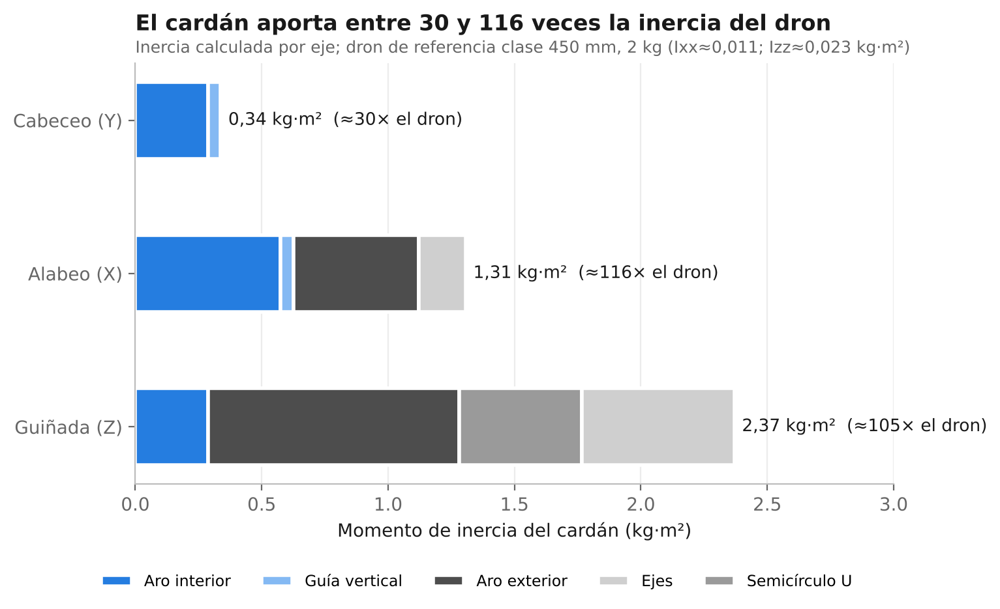

## 6.4 Rigidez de los aros

Los aros se modelaron como vigas curvas (144 elementos) con peso propio. El aro interior trabaja en su plano, apoyado en sus dos rodamientos y cargado en el fondo por la guía y el dron; el aro exterior trabaja fuera de su plano, apoyado en las chumaceras de pie y cargado en los pivotes del aro interior (Figura 7).

**Tabla 8.** Rigidez de los aros.

| Caso | Carga en el fondo del aro interior (N) | Desplazamiento fondo aro interior (mm) | Carga por pivote en aro exterior (N) | Flecha máx. aro exterior (mm) |
|---|---|---|---|---|
| Reposo, dron apoyado | 25,5 hacia abajo | 0,06 | 27,0 | 2,98 |
| Empuje máximo (T = 2 × peso) | 13,7 hacia arriba | 0,02 | 7,4 | 1,25 |

La flecha de 3,0 mm del aro exterior desplaza el centro del dron, pero no afecta la función del cardán.

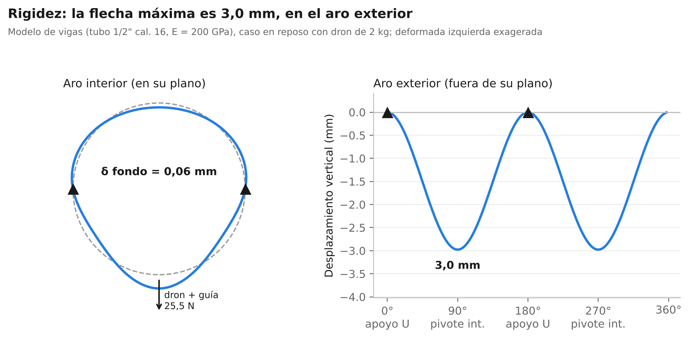

## 6.5 Resistencia de ejes

Cada eje se tomó como un voladizo de 40 mm entre el rodamiento y la unión soldada:

$$\sigma = \frac{32\,F\,a}{\pi d^3}$$

**Tabla 9.** Verificación de ejes.

| Eje | Ø (mm) | Carga radial (N) | σ flexión (MPa) | Factor de seguridad (Sy/σ) |
|---|---|---|---|---|
| Muñón aro interior (rodamiento 6004) | 20,0 | 27,0 | 1,38 | 153 |
| Brazo lateral aro exterior (chumacera de pie) | 22,2 | 45,1 | 1,67 | 126 |

## 6.6 Carga en rodamientos

**Tabla 10.** Verificación de rodamientos.

| Rodamiento | Carga (N) | Capacidad estática C0 (kN) | C0 / carga |
|---|---|---|---|
| Rodamiento 6004 (cabeceo, radial) | 27,0 | 5,0 [41] | 185 |
| Chumacera de pie 7/8" (alabeo, radial) | 45,1 | ≈ 7,85 | 174 |
| Chumacera plana 7/8" (guiñada, axial) | 112,4 | ≈ 7,85 | 70 |

El C0 de los insertos UC205 es un valor típico de catálogo, aproximado. En guiñada la carga es axial; conviene confirmar la capacidad axial del inserto con el fabricante.

## 6.7 Estabilidad gravitacional

Con el dron en el centro (50 cm) la masa de la guía queda debajo del eje y crea un par restaurador de hasta 1,47 N·m (Figura 8). Por encima de 6,5 cm sobre el centro el par se invierte y el sistema se comporta como un péndulo invertido; en el tope de 70 cm alcanza 3,04 N·m a 90°.

$$\tau(\theta) = \left(m_d\, g\, h + m_g\, g\, z_g\right)\sin\theta$$

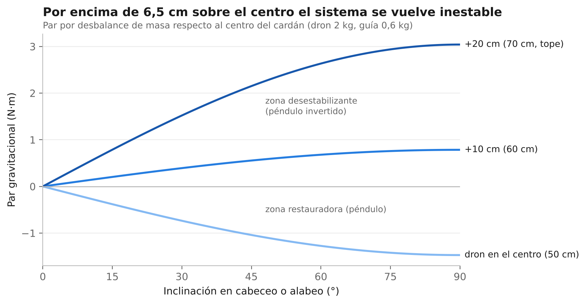

## 6.8 Espacio de trabajo

Los tres ejes de giro permiten 360° continuos, salvo cuando se bloquean con los soportes tipo freno. La traslación vertical es de 20 cm (50 → 70 cm desde la base de la guía).

# 7. Registro fotográfico

Las fotos muestran la estructura antes de pintar, el 26 de noviembre de 2026. Los originales están en `imagenes/implementacion/`.

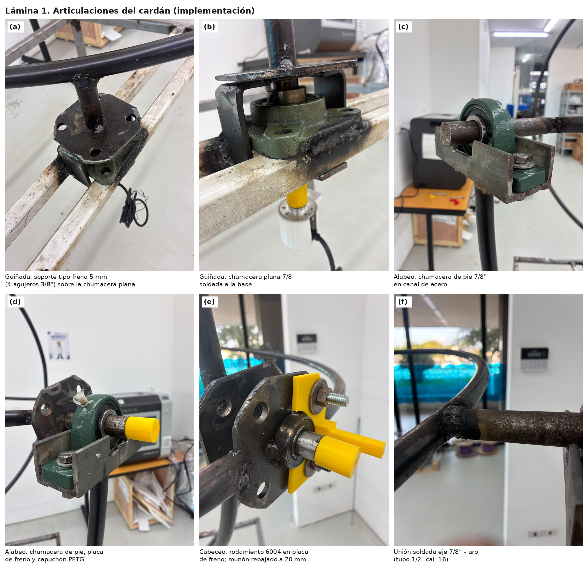

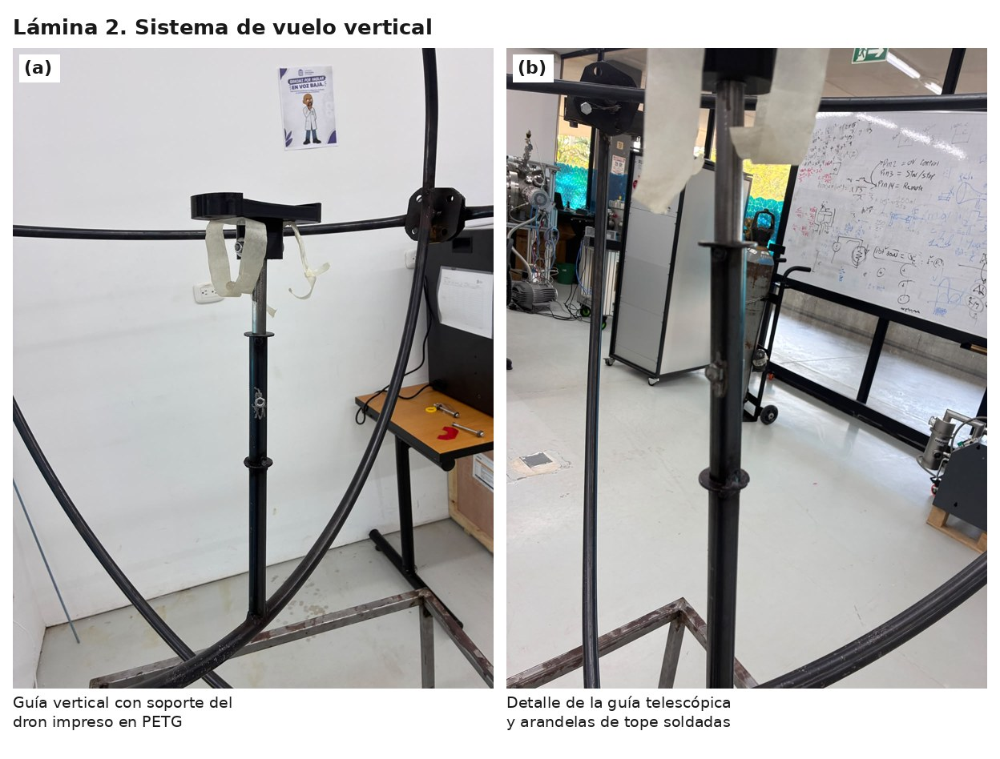

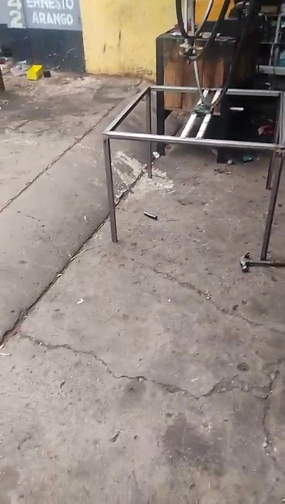

# 8. Protocolo de pruebas propuesto

**Tabla 11.** Pruebas propuestas y criterios de aceptación.

| Prueba | Procedimiento | Variable a registrar | Criterio |
|---|---|---|---|
| Giro libre de los ejes | Girar cada eje a mano sin dron, con los demás bloqueados | Fricción y holgura | Giro suave en todo el rango |
| Par de fricción | Colgar masas conocidas a un radio conocido hasta que el eje arranque | Par de arranque [N·m] | Reportarlo por eje |
| Fricción de la guía | Medir la fuerza para subir la guía en vacío (dinamómetro) | Fuerza [N] | Restarla del empuje en la prueba de levante |
| Prueba de levante | Ejes bloqueados en 0°; subir el acelerador hasta que el dron pase de 50 a 70 cm | % de acelerador al despegar | Despegue cercano al 50 % [47] |
| Relación empuje/peso | Empuje máximo (celda de carga o tabla del fabricante) | T/W | ≥ 2 [46] |
| Sintonía del lazo de tasa | Dron en punto muerto, soporte fijo con pasador; un eje libre a la vez | Respuesta a escalón | Sin oscilación ni sobreimpulso excesivo [48] |
| Comparación con vuelo libre | Repetir maniobras en vuelo libre con las ganancias halladas | Sobreimpulso y error estacionario | Documentar diferencias [10], [34] |

Las pruebas sobre la mesa no implican operación en el espacio aéreo; las de vuelo libre deben cumplir el RAC 100 [50].

# 9. Discusión: limitaciones y aportes

**Tabla 12.** Hallazgos de la literatura, resultados de la mesa y acciones.

| Tipo | Hallazgo de la literatura | Resultado en la mesa | Acción |
|---|---|---|---|
| Aporte | Los bancos de 3–4 GDL suelen ser para micro/nano drones o cuadricópteros de ~450 mm, impresos en 3D o en aluminio [1], [7], [9], [55]. | Aros de 1,20 y 1,00 m en tubo galvanizado admiten drones de hasta Ø 1,00 m, con materiales de taller y 637 000 COP en materiales. | Presentarlo como aporte de bajo costo y fabricación local. |
| Aporte | Pocos trabajos combinan rotación libre con traslación vertical [7], [9], [10], [39]. | La mesa reúne sintonía de actitud y prueba de levante, y los frenos permiten ensayar un eje a la vez. | Presentarlo como diferencial frente a bancos de 3 GDL y de empuje. |
| Riesgo | Aros y soportes añaden masa, inercia y fricción; las ganancias de banco difieren de las de vuelo libre [1], [7], [10], [34]. | El cardán aporta 30–116 veces la inercia del dron (sección 6.3). | Ensayar un eje a la vez, corregir el modelo con la inercia del cardán y comparar con vuelo libre; en una versión futura, aros de aluminio o fibra de carbono. |
| Riesgo | Un CG desplazado del centro de rotación genera un par tipo péndulo [4], [15], [55]. | Estable en el centro; inestable sobre 6,5 cm; 3,04 N·m en el tope de 70 cm (sección 6.7). | Sintonizar la actitud con el dron en punto muerto; usar el recorrido vertical para la prueba de levante. |
| Riesgo | En el eje vertical aparecen fricción y pandeo [7], [21], [37]. | La guía de tubo 1/2" en 5/8" con arandelas puede sumar fricción. | Medir la fuerza en vacío y descontarla. |
| Riesgo | Bloqueo de cardán (gimbal lock). | Cuando el aro interior gira 90°, dos ejes se alinean y se pierde un GDL. | Tenerlo en cuenta al planear maniobras. |
| Brecha | Pocos antecedentes colombianos de bancos cardán con recorrido vertical [26], [27]. | El proyecto ocupa un espacio poco cubierto en el país. | Usar [26] y [27] como antecedentes nacionales. |
| Método | La sintonía en banco se apoya en Ziegler-Nichols, relé o identificación previa [17], [18], [24], [46], [48]. | La mesa permite un protocolo repetible (capítulo 8). | Identificación → lazo de tasa → actitud → verificación de levante. |

Los resultados de este documento son calculados a partir de dimensiones nominales y de catálogo. Pesar los aros y medir el par de fricción servirá para validarlos.

# 10. Conclusiones y recomendaciones

## 10.1 Conclusiones

1. Se diseñó, fabricó e implementó una mesa de cuatro grados de libertad (tres rotacionales y uno vertical), la categoría menos representada en la literatura revisada: 3 de 39 fuentes.
2. Reunir en un solo equipo la sintonía de actitud y la verificación de levante es un aporte frente a los bancos cardán y a los bancos de empuje, que resuelven solo una de las dos pruebas.
3. La estructura está sobredimensionada en resistencia (factor de seguridad de ejes ≥ 126; C0/carga de rodamientos ≥ 70) y es suficientemente rígida (flecha máxima de 3,0 mm).
4. El límite del diseño es dinámico: el cardán aporta entre 30 y 116 veces la inercia de un dron de 2 kg, y el equilibrio se vuelve inestable cuando el dron sube más de unos 6,5 cm sobre el centro.
5. La fabricación con tubo galvanizado, soldadura SMAW e impresión 3D permite un banco de gran tamaño con procesos de taller accesibles y unos 637 000 COP en materiales.

## 10.2 Recomendaciones

1. Pesar los aros y la guía, y medir el par de fricción de cada eje, para validar los resultados calculados.
2. Sintonizar la actitud con el dron en punto muerto y un eje libre a la vez, y validar las ganancias en vuelo libre.
3. Caracterizar la fricción de la guía y descontarla de la prueba de levante.
4. Evaluar aros más livianos (aluminio o fibra de carbono) para reducir la inercia añadida.
5. Elaborar los planos en PDF (vista general con cotas y despiece) a partir del modelo CAD.

# 11. Costos

Los materiales comprados costaron unos 637 000 COP (precios de noviembre de 2026, reportados por el autor). No incluye los ejes de acero de 7/8", la lámina de 5 mm, los electrodos ni la mano de obra.

**Tabla 13.** Costo de materiales.

| Material | Cantidad | Precio unitario (COP) | Subtotal (COP) |
|---|---|---|---|
| Tubo galvanizado 1/2" cal. 16 × 6 m | 4 | 72 000 | 288 000 |
| Chumacera de pie 7/8" | 2 | 45 000 | 90 000 |
| Impresión 3D en PETG | — | — | 80 000 |
| Tubo cuadrado 1" × 6 m | 2 | 24 000 | 48 000 |
| Chumacera plana 7/8" | 1 | 45 000 | 45 000 |
| Rodamiento 6004 | 2 | 18 000 | 36 000 |
| Tubo galvanizado 5/8" × 6 m | 1 | 30 000 | 30 000 |
| Tornillería | — | — | 20 000 |
| **Total** | | | **637 000** |

# Anexo A. Información pendiente

- Diámetro exterior real del tubo de 1/2" (el CAD indica 19,5 mm; los cálculos usan 21,3 mm).
- Masa medida de la guía vertical con el soporte del dron (se asumió 0,6 kg).
- Planos en PDF y fotografía del producto terminado (después de pintar y montar).

# Anexo B. Matriz del estado del arte

La matriz está en `estado_del_arte/Estado_del_arte_mesa_drones.xlsx`, con las hojas: Resumen (conteos por categoría, tipo, región y relevancia), Matriz estado del arte (39 fuentes con autores, año, tipo, país, categoría, descripción, aporte, relación con el proyecto, relevancia y enlace), Equipos comerciales, Referencias técnicas, Comparativo por GDL, Brechas y aportes y Búsquedas.

# Referencias

[1] Sharma, S.; Dijkstra, T.; Venkatesha Prasad, R., "Open Gimbal: A 3 Degrees of Freedom Open Source Sensing and Testing Platform for Nano and Micro UAVs," TU Delft; preprint arXiv:2310.02678, 2023. https://arxiv.org/abs/2310.02678

[2] Hancer, M.; Bitirgen, R.; Bayezit, I., "Designing 3-DOF Hardware-In-The-Loop Test Platform Controlling Multirotor Vehicles," IFAC-PapersOnLine 51(4), 119-124, 2018. https://skoge.folk.ntnu.no/prost/proceedings/PID-2018/0168.PDF

[3] Veyna, U.; Garcia-Nieto, S.; Simarro, R.; Salcedo, J. V., "Quadcopters Testing Platform for Educational Environments," Sensors 21(12), 4134, 2021. https://doi.org/10.3390/s21124134

[4] Ahmad, S. M.; Fareed, S., "Attitude modelling and real-time robust control of a 3-DoF quadcopter UAV test bench," The Aeronautical Journal, 2024. https://doi.org/10.1017/aer.2024.11

[5] Bondyra, A.; Gąsior, P.; Gardecki, S., "Experimental Test Bench for Multirotor UAVs," Automation 2017, AISC vol. 550, 330-338, 2017. https://doi.org/10.1007/978-3-319-54042-9_30

[6] Gąsior, P.; Bondyra, A.; Gardecki, S., "Initial Tuning Procedure for Attitude and Vertical Movement Controllers in Multirotor Aerial Vehicles with Heterogeneous Propulsion Units," ICINCO 2018. https://scitepress.org/PublishedPapers/2018/69113/pdf/index.html

[7] Botha, N.; de Ronde, W.; van Eden, B., "Design of a 3D-printed test rig for micro aerial robotics platforms," MATEC Web of Conferences 406, 04017, 2024. https://doi.org/10.1051/matecconf/202440604017

[8] Mukras, S. M. S.; Omar, H. M., "Development of a 6-DOF Testing Platform for Multirotor Flying Vehicles with Suspended Loads," Aerospace 8(11), 355, 2021. https://doi.org/10.3390/aerospace8110355

[9] Di Lorenzo, E., "A novel 4 degrees of freedom quadcopter test bench," Politecnico di Milano, 2020. https://www.politesi.polimi.it/handle/10589/171116

[10] Berndt Barriga, A., "Implementación y puesta a punto de banco de ensayos de 4 grados de libertad para drones multirotor," Universidad de Concepción, 2024. https://repositorio.udec.cl/handle/11594/12411

[11] Sidón Ayala, M. Á., "Diseño de un banco de pruebas para vehículos aéreos de cuatro rotores," CICESE, 2020. https://cicese.repositorioinstitucional.mx/jspui/handle/1007/3272

[12] Madrid Solís, C., "Instrumentación de una plataforma experimental tipo cardán para la medición y estimación de estados de un VANT cuadrirrotor," TecNM Hermosillo, 2019. https://rinacional.tecnm.mx/jspui/bitstream/TecNM/5185/1/2019-151_Carlos_Madrid_Solis.pdf

[13] Castillo Lou, S. J., "Implementación y desarrollo de plataforma tipo gimbal para pruebas de control de drones de mediana potencia," Universidad del Valle de Guatemala, 2022. https://repositorio.uvg.edu.gt/bitstreams/073146fc-c4b2-485e-81a4-4e1790b585a9/download

[14] Rico-Azagra, J.; Gil-Martínez, M.; Rico, R.; Nájera, S.; Elvira Izurrategui, C., "Benchmark de control de la orientación de un multirrotor en una estructura de rotación con tres grados de libertad," RIAI, 2021. https://riunet.upv.es/handle/10251/168909

[15] Nájera, S.; Zambrano, F. A.; Rico, R.; Rico-Azagra, J.; Gil-Martínez, M., "Plataforma giroscópica mejorada para la práctica docente en Ingeniería de control," Universidad de La Rioja, 2023. https://investigacion.unirioja.es/documentos/6566402800fa755ab9bc700a/f/657b31b4aaaaaa46358cbc15.pdf

[16] Yüzgeç, U. et al., "Development of the Test Platform for Rotary Wing Unmanned Air Vehicle," Bilecik Şeyh Edebali Üniv. Fen Bilimleri Dergisi 3(2), 2016. https://dergipark.org.tr/en/download/article-file/368163

[17] Pehlivan, K.; Aküner, M. C., "Designing PID Controller for Quadrotor Test Bench and Implementation," PORTA 2(1), 15-24, 2020. https://doi.org/10.35333/porta.2020.209

[18] Khudairi, H. et al., "Dynamic Modelling and System Identification of a Quadrotor Unmanned Aerial Vehicle Using Gyroscopic Based Test Stand," Progress in Aerospace and Aviation Technology, 2025. https://doi.org/10.30880/paat.2025.05.02.004

[19] Xuan-Mung, N.; Hong, S.-K., "A Multicopter Ground Testbed for the Evaluation of Attitude and Position Controller," International Journal of Engineering & Technology 7, 65-73, 2018. https://www.sciencepubco.com/index.php/ijet/article/view/23708

[20] Yu, Y.; Ding, X., "A quadrotor test bench for six degree of freedom flight," Journal of Intelligent & Robotic Systems, 2012. https://doi.org/10.1007/s10846-012-9680-y

[21] Jin, J.; Jo, J.-H., "A Test Bench with Six Degrees of Freedom of Motion For Development of Small Quadrotor Drones," Journal of Aerospace System Engineering, 2017. https://koreascience.kr/article/JAKO201713059662488.pdf

[22] Dong, W.; Gu, G.-Y.; Zhu, X.; Ding, H., "Development of a Quadrotor Test Bed — Modelling, Parameter Identification, Controller Design and Trajectory Generation," International Journal of Advanced Robotic Systems 12(2), 2015. https://softrobotics.sjtu.edu.cn/pdf/20.pdf

[23] Beharie, M. M.; Pedro, J. O.; Dala, L., "Design of a quadrotor flight test stand for system identification," The Aeronautical Journal 119(1214), 501-521, 2015. https://doi.org/10.1017/S0001924000010587

[24] Hoshu, A. A.; Wang, L.; Sattar, A.; Fisher, A., "Auto-Tuning of Attitude Control System for Heterogeneous Multirotor UAS," Remote Sensing 14(7), 1540, 2022. https://doi.org/10.3390/rs14071540

[25] Prach, A.; Kayacan, E.; Bernstein, D. S., "An Experimental Evaluation of the Forward Propagating Riccati Equation to Nonlinear Control of the Quanser 3 DOF Hover Testbed," 2016. https://websites.umich.edu/~dsbaero/library/ConferencePapers/FPREPrach.pdf

[26] Quitian Niño, L. C., "Construcción de bancos de prueba para la medición experimental de los parámetros del modelo dinámico de Drones - UAS," Universidad Nacional de Colombia, sede Bogotá, 2022. https://repositorio.unal.edu.co/handle/unal/82845

[27] Blanco Ortiz, R. A., "Diseñar e implementar una planta de pruebas para un cuadricóptero," Universidad Distrital Francisco José de Caldas, 2016. https://repository.udistrital.edu.co/items/c0e072e6-71f4-4b2c-acd9-6998d5669084

[28] Jiménez Flores, A.; Reyes Osorio, L. A. et al., "Diseño y construcción de un banco de pruebas de bajo costo para drones," Ingenierías (UANL) 29(101), 2026. https://ingenierias.uanl.mx/index.php/i/article/download/991/1318/2746

[29] Romero Paredes, R. A., "Diseño e implementación de una plataforma multi-rotor de tres grados de libertad comandada por medio de gestos realizados con la mano," Escuela Politécnica Nacional, 2022. https://bibdigital.epn.edu.ec:443/bitstream/15000/22245/1/CD%2011748.pdf

[30] Hernández Yánez, J. D.; Nandar Carvajal, J. E., "Implementación de un banco de pruebas para el sistema de propulsión de un UAV de ala fija," Escuela Politécnica Nacional, 2021. https://bibdigital.epn.edu.ec:443/bitstream/15000/22132/1/CD%2011629.pdf

[31] Rieger, C.; Holzäpfel, A. L.; Hornung, M., "Enhancement of a modular and versatile UAV propeller force measurement system," DGLR, 2023. https://dglr.de/publikationen/2023/550030.pdf

[32] M, P.; Manoharan, D.; Chandramohan, S.; Chakkath, S. et al., "Design, Development & Testing of Test Rig Setup for UAV Propulsion System," SAE Technical Paper 2017-01-2064, 2017. https://doi.org/10.4271/2017-01-2064

[33] Gupta, N. K., "Development of a Test-Bed for Closed-Loop MAV Flight Control," University of Maryland, 2006. https://api.drum.lib.umd.edu/server/api/core/bitstreams/5f880be0-1514-4fa3-9a1d-44a33950ab52/content

[34] "Robust and Agile Quadrotor Flight via Adaptive Unwinding-Free Quaternion Sliding Mode Control," arXiv:2508.06568, 2025. https://arxiv.org/pdf/2508.06568

[35] KSCST Student Project Programme, "Design and fabrication of a 3DOF gimbal mechanism for drone mounting and PID tuning," serie 47, s. f. https://kscst.org.in/spp/47_series/47s_spp/Exhibition%20Projects/155_47S_BE_2767.pdf

[36] Comunidad ArduPilot, "Test stand tutorials (PIDrig)," ArduPilot Discourse, s. f. https://discuss.ardupilot.org/t/test-stand-tutorials/113

[37] Patente US 8,353,199, "Multi-degree-of-freedom test stand for unmanned air vehicles," USPTO. https://image-ppubs.uspto.gov/dirsearch-public/print/downloadPdf/8353199

[38] Patente CN103010483A, "Two-DOF test platform for micro aerial vehicle," CNIPA, 2012. https://patents.google.com/patent/CN103010483A/en

[39] Patente US 11,674,867, "Unmanned aerial vehicle (UAV) test bench," USPTO. https://image-ppubs.uspto.gov/dirsearch-public/print/downloadPdf/11674867

[40] Schaeffler, "Rodamiento rígido de bolas 6004," catálogo en línea. https://medias-at.schaeffler.com/en/product/rotary/rolling-and-plain-bearings/ball-bearings/deep-groove-ball-bearings/6004/p/352948

[41] SKF vía RS Components, "SKF 6004 Single Row Deep Groove Ball Bearing." https://uk.rs-online.com/web/p/ball-bearings/2867631

[42] Lincoln Electric, ficha técnica electrodo E6013 (AWS A5.1). https://ch-delivery.lincolnelectric.com/api/public/content/04a550042a554477990d30f4970d6357

[43] Guessasma, S.; Belhabib, S.; Nouri, H., Polymers 11(7), 1220, 2019 (PETG impreso por FDM). https://doi.org/10.3390/polym11071220

[44] Tien, Trinh y Ngo, Journal of Mechanical Engineering 75(1), 2025 (PETG impreso por FDM). https://doi.org/10.2478/scjme-2025-0004

[45] Polymers 17(23), 3175, 2025 (optimización de parámetros de PETG). https://doi.org/10.3390/polym17233175

[46] Tyto Robotics, "How Much Weight Can a Drone Carry." https://www.tytorobotics.com/blogs/articles/how-much-weight-can-a-drone-carry

[47] T-Motor, guía de emparejamiento del sistema de propulsión. https://uav-en.tmotor.com/blog/multirotor-uav-propulsion-system-guide.html

[48] PX4, "Multicopter PID Tuning Guide." https://docs.px4.io/main/en/config_mc/pid_tuning_guide_multicopter.html

[49] ArduPilot, "AutoTune (Copter)." https://ardupilot.org/copter/docs/autotune.html

[50] Aerocivil, RAC 100 (Resolución 01983 de 2023). https://www.aerocivil.gov.co/normatividad/RAC/RAC%20%20100-Operación%20de%20Sistemas%20de%20Aeronaves%20no%20Tripuladas%20UAS.pdf

[51] Quanser, "3 DOF Hover," ficha de producto. https://www.quanser.com/products/3-dof-hover/

[52] Quanser, "3 DOF Helicopter," ficha de producto. https://quanser.com/?p=5701

[53] Tyto Robotics, "Series 1585," ficha de producto. https://www.tytorobotics.com/pages/series-1580-1585

[54] Tyto Robotics, "Flight Stand 150 / 500," ficha de producto. https://www.tytorobotics.com/pages/thrust-stands

[55] Eureka Dynamics, "FFT-GYRO," ficha de producto. https://eurekadynamics.com/product.html
