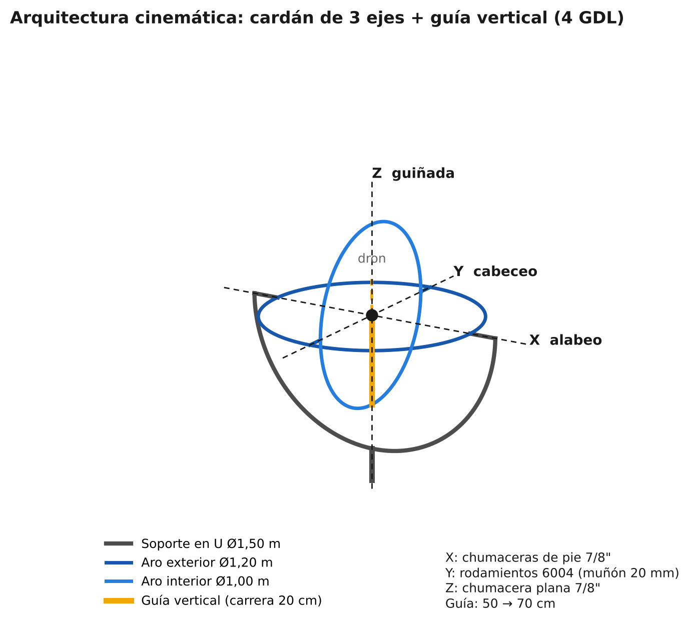
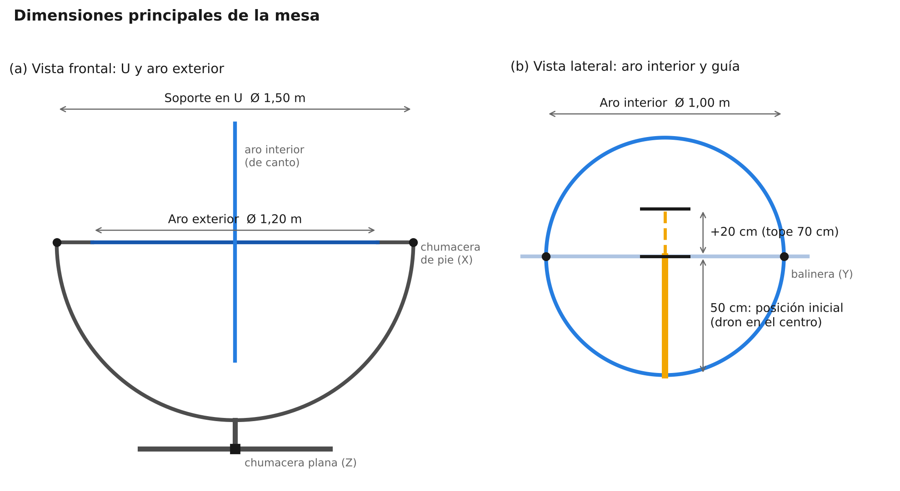
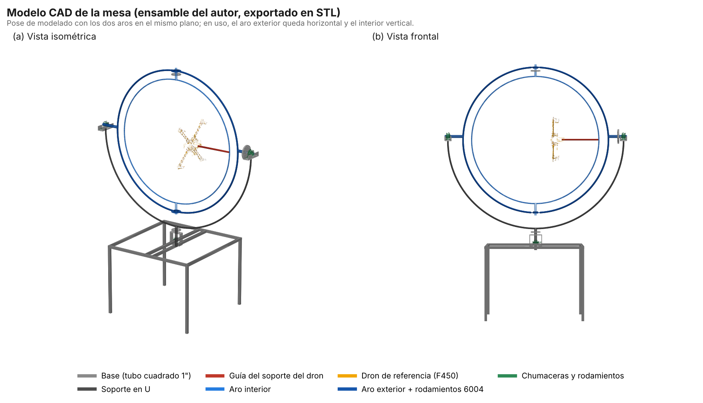
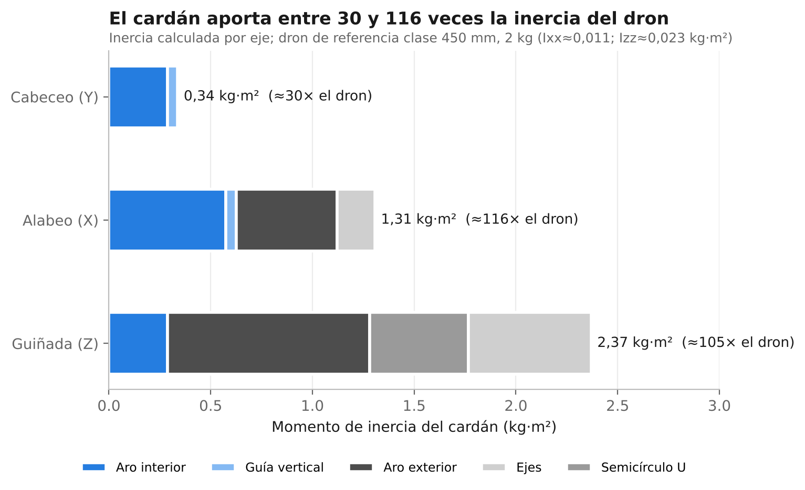
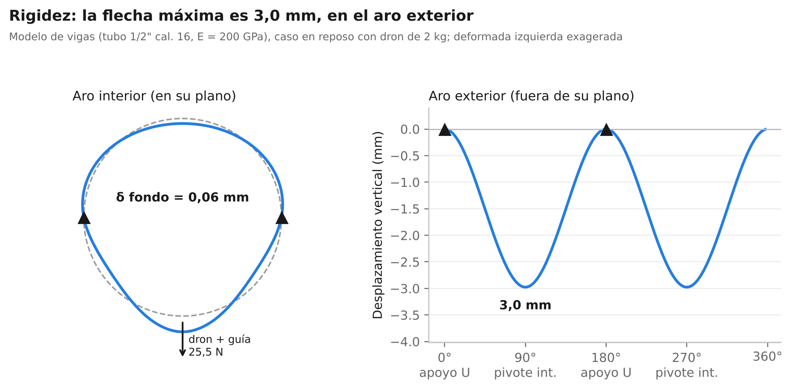
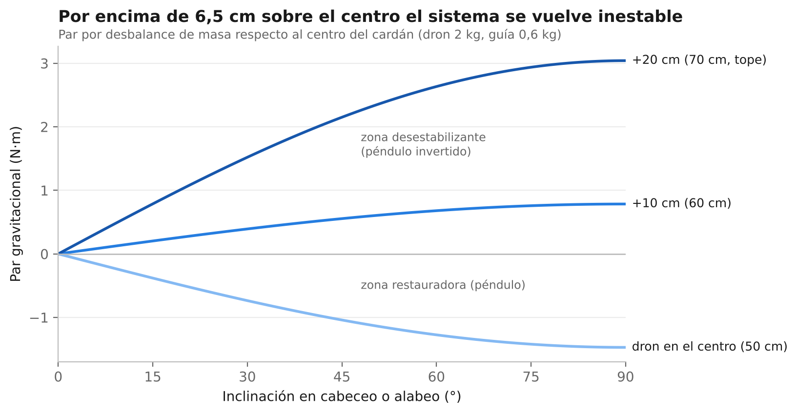
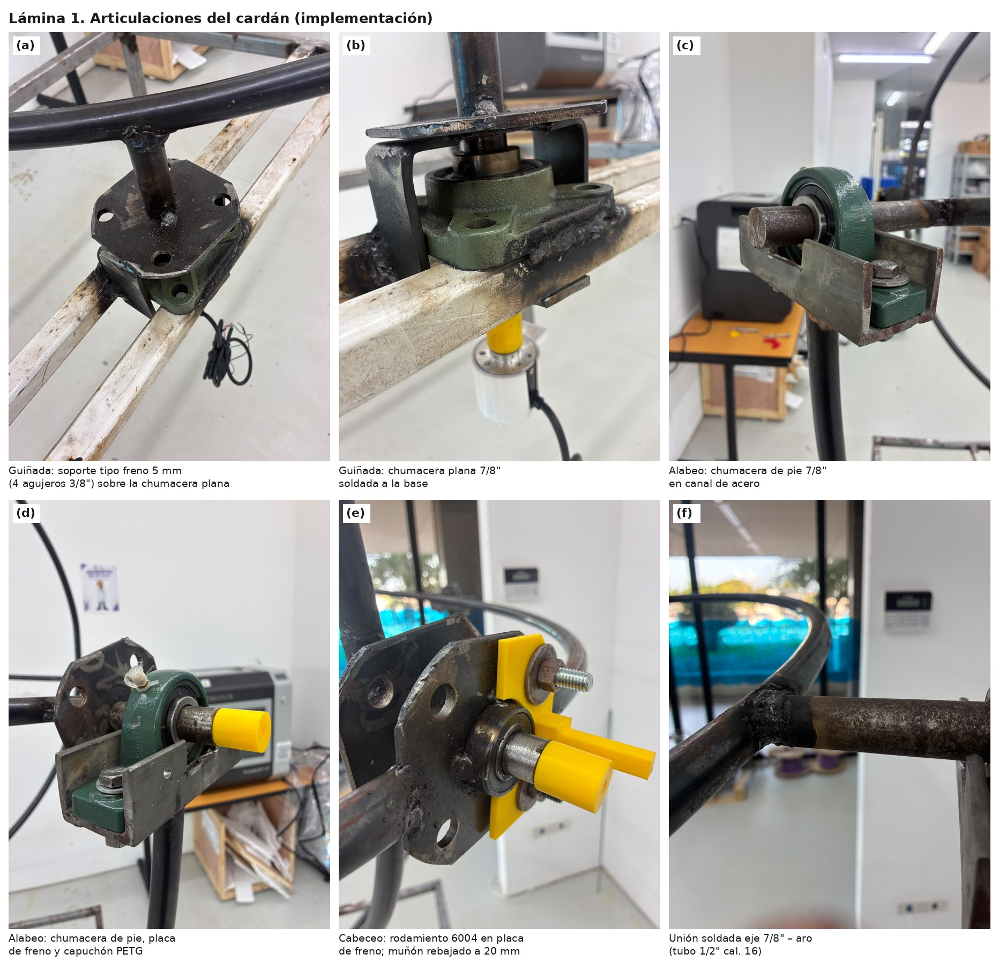
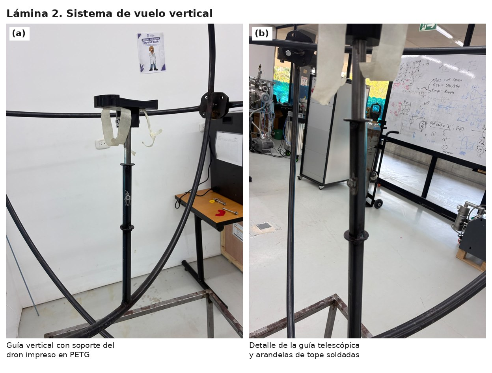

# Mesa de sintonización para drones – Documento base y resultados mecánicos

Autor: Maicol Ardila · Versión: 26 de noviembre de 2026 · Documento base para el profesor (sin plantilla). Versión editable en línea: [Claude Docs](https://claude.ai/artifact/5ZTyACr74py4uFoJBr7NVR).

## 1. Resumen y alcance

Se diseñó, fabricó e implementó una mesa de sintonización para drones con 4 grados de libertad: un cardán de tres ejes (guiñada, alabeo y cabeceo) más una guía vertical con 20 cm de carrera. El dron vuela restringido en el centro del cardán, sin soltarse, para ajustar el controlador y verificar si los motores levantan su peso.

El aporte del autor en esta etapa es mecánico: concepto, dimensionamiento, selección de rodamientos, mecanizado de ejes, soldadura y montaje. Este documento reúne esos datos y los resultados mecánicos calculados (masas, inercias, rigidez, resistencia de ejes y rodamientos, estabilidad gravitacional) para que sirvan de base a una publicación.

**Hallazgos principales**

- La estructura está muy sobredimensionada en resistencia: factor de seguridad a fluencia mayor de 120 en ejes y relación capacidad estática/carga mayor de 70 en rodamientos.
- El límite real del diseño es dinámico: el cardán aporta entre 30 y 116 veces la inercia de un dron de 2 kg, y eso afecta la sintonización.
- La flecha máxima calculada es 3,0 mm, en el aro exterior; el aro interior se deforma menos de 0,1 mm.
- El equilibrio cambia con la altura del dron: estable en el centro (50 cm) e inestable por encima de unos 6,5 cm sobre el centro.
- Los materiales comprados costaron unos 637 000 COP.

## 2. Descripción del sistema

La mesa es un cardán de tres aros concéntricos cuyos ejes se cruzan en un punto, donde se ubica el dron. Cada eje usa un tipo de apoyo distinto (Figura 1 y Figura 2).

| Eje | Movimiento | Elemento móvil | Apoyo | Rango |
| --- | --- | --- | --- | --- |
| Z (vertical) | Guiñada | Soporte en U, Ø 1,50 m | 1 chumacera plana 7/8" soldada a la base | 360° |
| X (horizontal) | Alabeo | Aro exterior, Ø 1,20 m (horizontal en reposo) | 2 chumaceras de pie 7/8" en las puntas de la U | 360° |
| Y (horizontal, ⊥ X) | Cabeceo | Aro interior, Ø 1,00 m (vertical en reposo) | 2 rodamientos 6004 en placas soldadas al aro exterior | 360° |
| Z (traslación) | Altura | Guía vertical telescópica | Tubo dentro de tubo con arandelas de tope | 50 → 70 cm (20 cm) |

La guía vertical sale del punto inferior del aro interior. En su posición inicial mide 50 cm, igual al radio del aro interior, así que el soporte del dron queda exactamente en el centro del cardán. Al subir a 70 cm, el dron queda 20 cm por encima del centro.

Cada eje tiene un soporte tipo freno en lámina de acero de 5 mm con 4 agujeros de 3/8" (9,5 mm). Un perno por esos agujeros bloquea el eje en la posición 0°, que es la posición de prueba (punto muerto, con el dron en el centro de la mesa), o en pasos de 45° hasta completar 360°.

El soporte del dron gira libre sobre la guía cuando se retira su pasador. La mesa tiene dos modos de uso:

- **Sintonización:** el soporte del dron va fijo con el pasador y los ejes del cardán quedan libres (todos, o uno a la vez bloqueando los demás).
- **Prueba de empuje:** los tres ejes se bloquean en 0° y el dron solo puede subir por la guía; así se comprueba si los motores levantan su peso.

La mesa admite cualquier dron que quepa dentro del aro interior de Ø 1,00 m. Sus dimensiones generales son unos 2,20 m de alto (base de 80 cm + eje de 12 cm + semicírculo en U + aro interior) y 1,80 m de ancho.

*Figura 1. Arquitectura cinemática: cardán de 3 ejes y guía vertical (4 GDL).*

*Figura 2. Dimensiones principales: (a) vista frontal de la U y el aro exterior; (b) vista lateral del aro interior y la guía.*

El autor modeló el ensamble completo en CAD, con rodamientos, chumaceras y un dron F450 de referencia (Figura 6). Los archivos STL están en [`cad/`](../cad).

*Figura 6. Modelo CAD de la mesa, en pose de modelado con los aros en el mismo plano: (a) vista isométrica; (b) vista frontal.*

## 3. Materiales y componentes

Todos los ejes y alojamientos se unificaron en 7/8" (22,2 mm), salvo los muñones del aro interior, rebajados a 20 mm.

| Componente | Cant. | Especificación | Ubicación / función |
| --- | --- | --- | --- |
| Chumacera plana (brida, 2 agujeros) | 1 | Eje 7/8" (tipo UCFL205-14) | Eje de guiñada, soldada a la base |
| Chumacera de pie | 2 | Eje 7/8" (tipo UCP205-14) | Eje de alabeo, en canales de acero en las puntas de la U |
| Rodamiento rígido de bolas 6004 | 2 | 20 × 42 × 12 mm | Eje de cabeceo, en placas de 5 mm soldadas al aro exterior |
| Eje vertical de la U | 1 | Acero SAE 1020, Ø 7/8", 18 cm | Guiñada: une la U con la chumacera plana |
| Brazos laterales | 2 | Acero SAE 1020, Ø 7/8", 15 cm c/u | Alabeo: unen el aro exterior con las chumaceras de pie |
| Muñones del aro interior | 2 | Acero SAE 1020, Ø 7/8" torneado a Ø 20 mm, 10 cm c/u | Cabeceo: unen el aro interior con los rodamientos 6004 |
| Tubería galvanizada | 4 tubos de 6 m | 1/2", calibre 16 (Ø ext. 21,3 mm, e = 1,5 mm) | Semicírculo en U Ø 1,50 m; aros Ø 1,20 m y Ø 1,00 m |
| Soportes tipo freno | 3 | Lámina de acero 5 mm, octogonal, 4 agujeros de 3/8" | Bloqueo de cada eje en 0° y en pasos de 45° |
| Guía vertical | 1 | Tubo galvanizado 1/2" dentro de tubo 5/8", arandelas torneadas | Recorrido vertical del dron, 50 → 70 cm |
| Soporte del dron | 1 | PETG impreso, con pasador | Fijo (sintonización) o con giro libre sobre la guía |
| Base | 1 | Tubo cuadrado 1" (2 tubos de 6 m) | Bastidor inferior, 80 cm de alto |
| Soldadura | — | Electrodo E6013, ≈ 100 A | Todas las uniones |

Los rodamientos 6004 (20 × 42 × 12 mm) coinciden con los muñones rebajados a 20 mm del aro interior ([ficha SKF 6004, RS](https://uk.rs-online.com/web/p/ball-bearings/2867631)).

## 4. Proceso de fabricación

La mesa se construyó con procesos de taller convencionales: curvado, torneado, soldadura por arco e impresión 3D.

1. Curvado de la tubería galvanizada de 1/2" cal. 16 para formar el semicírculo en U (Ø 1,50 m), el aro exterior (Ø 1,20 m) y el aro interior (Ø 1,00 m).
2. Corte de los ejes de 7/8" y torneado de los muñones del aro interior a Ø 20 mm para alojar las balineras.
3. Corte de los soportes tipo freno en lámina de acero de 5 mm (perfil octogonal con agujeros pasantes).
4. Soldadura de los ejes a los aros en unión en T (Lámina 1f) y de las placas porta-balinera al aro exterior, con electrodo E6013 a unos 100 A.
5. Montaje de la chumacera plana sobre la base y de las chumaceras de pie en canales de acero atornillados en las puntas de la U.
6. Fabricación de la guía vertical telescópica con arandelas de tope soldadas (Lámina 2b).
7. Impresión en PETG del soporte del dron y de los capuchones y soportes auxiliares de los ejes.

Pendiente: pintura, montaje de componentes restantes y fotografía del producto terminado.

## 5. Resultados mecánicos

La mesa resiste con mucho margen; lo que limita el diseño es la inercia y el balance de masas. Los cálculos están en [`analisis/calculos_mecanicos.py`](../analisis/calculos_mecanicos.py) y se pueden repetir con datos medidos; las tablas en CSV están en [`datos/`](../datos).

### 5.1 Hipótesis de cálculo

| Parámetro | Valor usado | Origen |
| --- | --- | --- |
| Tubo 1/2" cal. 16 | Ø ext. 21,3 mm, e = 1,5 mm → 0,732 kg/m, I = 4 599 mm⁴ | Calibre 16 y Ø nominal de 1/2" |
| Masa lineal del tubo | P = 0,0246615 · e · (D − e) kg/m | Fórmula de tubo estructural redondo |
| Eje 7/8" | Acero SAE 1020, 3,05 kg/m, Sy = 210 MPa (laminado en caliente) | Grado confirmado; Sy conservador |
| Longitudes de ejes | Eje de la U 18 cm; brazos laterales 15 cm; muñones 10 cm | Medidas del autor; muñones por geometría (0,60 − 0,50 m) |
| Acero | ρ = 7 850 kg/m³, E = 200 GPa, G = 79 GPa | Estándar |
| Dron de cálculo | 2,0 kg, empuje/peso = 2 (T máx = 39,2 N) | Caso de referencia; la mesa admite cualquier dron dentro de Ø 1,00 m |
| Guía vertical + soporte | 0,6 kg | Valor asumido, por pesar |
| Voladizo eje–rodamiento | 40 mm | Valor asumido |

### 5.2 Masas calculadas

| Componente | Longitud (m) | Masa (kg) |
| --- | --- | --- |
| Aro exterior Ø 1,20 m | 3,77 | 2,76 |
| Aro interior Ø 1,00 m | 3,14 | 2,30 |
| Semicírculo en U Ø 1,50 m | 2,36 | 1,73 |
| Brazos laterales 7/8" (2 × 15 cm) | 0,30 | 0,91 |
| Muñones 7/8" (2 × 10 cm) | 0,20 | 0,61 |
| Eje vertical de la U 7/8" | 0,18 | 0,55 |

La masa de los aros sale de su longitud (π × diámetro) por la masa lineal del tubo, y la de los ejes de su longitud por la masa lineal de la barra de 7/8". Aros y ejes suman 8,86 kg, sin contar placas, chumaceras ni la guía.

### 5.3 Inercia por eje

La inercia del cardán en cada eje es 0,34 kg·m² en cabeceo, 1,31 kg·m² en alabeo y 2,37 kg·m² en guiñada (Figura 3). Para un cuadricóptero de referencia de 2 kg y 450 mm (Ixx ≈ 0,011 kg·m²; Izz ≈ 0,023 kg·m², estimación propia con masas puntuales), eso equivale a 30, 116 y 105 veces la inercia del dron. Para los aros se usó el modelo de aro delgado, y para los ejes, el de barra radial:

$$I_{diámetro} = \tfrac{1}{2} m R^2 \qquad I_{normal} = m R^2 \qquad I_{barra} = \tfrac{m}{3}\left(r_1^2 + r_1 r_2 + r_2^2\right)$$

En alabeo pesa más el aro interior (0,58 kg·m²), porque gira alrededor de un eje normal a su plano; en guiñada domina el aro exterior (0,99 kg·m²) por la misma razón, y los ejes de 7/8" aportan 0,60 kg·m² por estar lejos del centro.

*Figura 3. Momento de inercia del cardán por eje y aporte de cada componente.*

### 5.4 Rigidez de los aros

Se modelaron los aros como vigas curvas (144 elementos) con peso propio. El aro interior trabaja en su plano, apoyado en sus dos balineras y cargado en el fondo por la guía y el dron; el aro exterior trabaja fuera de su plano, apoyado en las chumaceras de pie y cargado en los pivotes del aro interior (Figura 4).

| Caso | Carga en el fondo del aro interior (N) | Desplazamiento fondo aro interior (mm) | Carga por pivote en aro exterior (N) | Flecha máx. aro exterior (mm) |
| --- | --- | --- | --- | --- |
| Reposo, dron apoyado | 25,5 hacia abajo | 0,06 | 27,0 | 2,98 |
| Empuje máximo (T = 2 × peso) | 13,7 hacia arriba | 0,02 | 7,4 | 1,25 |

La flecha de 3,0 mm del aro exterior desplaza el centro del dron, pero no afecta la función del cardán.

*Figura 4. Deformada del aro interior (exagerada) y flecha del aro exterior, caso en reposo.*

### 5.5 Resistencia de ejes

Se tomó cada eje como un voladizo de 40 mm entre el rodamiento y la unión soldada:

$$\sigma = \frac{32\,F\,a}{\pi d^3}$$

| Eje | Ø (mm) | Carga radial (N) | σ flexión (MPa) | Factor de seguridad (Sy/σ) |
| --- | --- | --- | --- | --- |
| Muñón aro interior (rodamiento 6004) | 20,0 | 27,0 | 1,38 | 153 |
| Brazo lateral aro exterior (chumacera de pie) | 22,2 | 45,1 | 1,67 | 126 |

### 5.6 Carga en rodamientos

| Rodamiento | Carga (N) | Capacidad estática C0 (kN) | C0 / carga |
| --- | --- | --- | --- |
| Rodamiento 6004 (cabeceo, radial) | 27,0 | 5,0 | 185 |
| Chumacera de pie 7/8" (alabeo, radial) | 45,1 | ≈ 7,85 | 174 |
| Chumacera plana 7/8" (guiñada, axial) | 112,4 | ≈ 7,85 | 70 |

C0 del 6004 tomado de la [ficha SKF 6004](https://uk.rs-online.com/web/p/ball-bearings/2867631) (5,0 kN); C0 de los insertos UC205 es un valor típico de catálogo, aproximado. En guiñada la carga es axial; conviene confirmar la capacidad axial del inserto con el fabricante.

### 5.7 Estabilidad gravitacional

Con el dron en el centro (50 cm) la masa de la guía queda debajo del eje y crea un par restaurador de hasta 1,47 N·m (Figura 5). Por encima de 6,5 cm sobre el centro el par se invierte y el sistema se comporta como un péndulo invertido; en el tope de 70 cm alcanza 3,04 N·m a 90°.

$$\tau(\theta) = \left(m_d\, g\, h + m_g\, g\, z_g\right)\sin\theta$$

*Figura 5. Par gravitacional según la inclinación, para tres alturas del dron.*

### 5.8 Espacio de trabajo

Los tres ejes de giro permiten 360° continuos, salvo cuando se bloquean con los soportes tipo freno. La traslación vertical es de 20 cm (50 → 70 cm desde la base de la guía).

## 6. Registro fotográfico

Las fotos muestran la estructura antes de pintar, el 26 de noviembre de 2026. Los originales están en [`imagenes/implementacion/`](../imagenes/implementacion) con nombres descriptivos.

| Lámina | Foto | Contenido |
| --- | --- | --- |
| 1a | foto03 | Guiñada: soporte tipo freno de 5 mm (4 agujeros de 3/8") sobre la chumacera plana |
| 1b | foto02 | Guiñada: chumacera plana 7/8" soldada a la base de tubo cuadrado |
| 1c | foto01 | Alabeo: chumacera de pie 7/8" en canal de acero |
| 1d | foto05 | Alabeo: chumacera de pie con soporte tipo freno y capuchón PETG |
| 1e | foto06 | Cabeceo: rodamiento 6004 en placa de freno; muñón rebajado a 20 mm; pieza PETG con perno |
| 1f | foto08 | Unión soldada en T entre eje 7/8" y aro |
| 2a | foto04 | Guía vertical con soporte del dron impreso en PETG |
| 2b | foto07 | Guía telescópica con arandelas de tope soldadas |

Falta la foto del producto terminado, que se tomará después de pintar y montar.

*Lámina 1. Articulaciones del cardán: guiñada (a, b), alabeo (c, d), cabeceo (e) y unión soldada (f).*

*Lámina 2. Sistema de vuelo vertical: guía con soporte PETG (a) y detalle telescópico (b).*

## 7. Discusión, limitaciones y trabajo pendiente

La estructura de acero es segura y económica, pero su inercia dominará la respuesta en vuelo restringido. Las ganancias de un controlador ajustadas con los tres ejes libres no se pueden pasar directamente al vuelo libre.

- **Inercia añadida.** Con 30–116 veces la inercia del dron, conviene ensayar un eje a la vez (bloqueando los otros con los frenos) y corregir el modelo dinámico con la inercia del cardán. Una versión futura podría usar tubo de aluminio o fibra de carbono.
- **Balance.** Para que el banco sea neutro, el centro de masa del conjunto dron + guía debe quedar sobre el centro del cardán. Hoy eso ocurre unos 6,5 cm por encima del centro, según las masas usadas; se puede verificar midiendo.
- **Fricción y juego.** Los sellos de las chumaceras añaden par de fricción que no se ha medido. Un ensayo simple es colgar masas conocidas a un radio conocido hasta que el eje arranque.
- **Bloqueo de cardán (gimbal lock).** Cuando el aro interior gira 90°, dos ejes se alinean y se pierde un grado de libertad; es propio de la arquitectura.
- **Resultados calculados, no medidos.** Masas, inercias y flechas salen de dimensiones nominales y de catálogo. Pesar los aros serviría para validarlas.

**Pendiente:** pintura, montaje final, foto del producto terminado, archivo CAD en el repositorio y ensayos de fricción e inercia.

## 8. Costos

Los materiales comprados costaron unos 637 000 COP (precios de noviembre de 2026, reportados por el autor). No incluye los ejes de acero de 7/8", la lámina de 5 mm, los electrodos ni la mano de obra.

| Material | Cantidad | Precio unitario (COP) | Subtotal (COP) |
| --- | --- | --- | --- |
| Tubo galvanizado 1/2" cal. 16 × 6 m | 4 | 72 000 | 288 000 |
| Chumacera de pie 7/8" | 2 | 45 000 | 90 000 |
| Impresión 3D en PETG | — | — | 80 000 |
| Tubo cuadrado 1" × 6 m | 2 | 24 000 | 48 000 |
| Chumacera plana 7/8" | 1 | 45 000 | 45 000 |
| Rodamiento 6004 | 2 | 18 000 | 36 000 |
| Tubo galvanizado 5/8" × 6 m | 1 | 30 000 | 30 000 |
| Tornillería | — | — | 20 000 |
| **Total** | | | **637 000** |

Pendiente: archivo CAD nativo o STEP, planos en PDF y foto del producto terminado.
